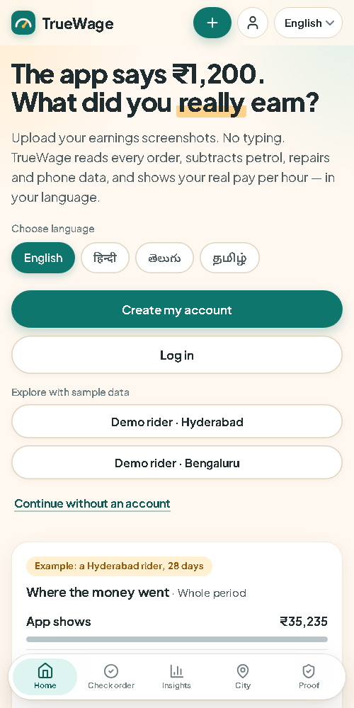
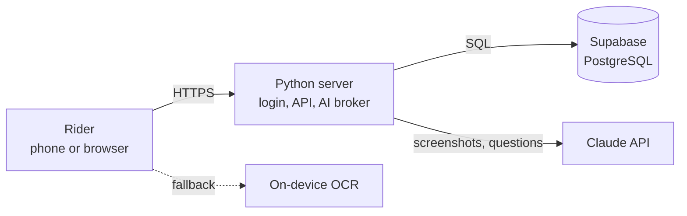
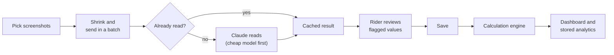
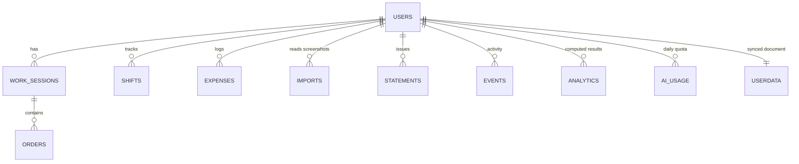
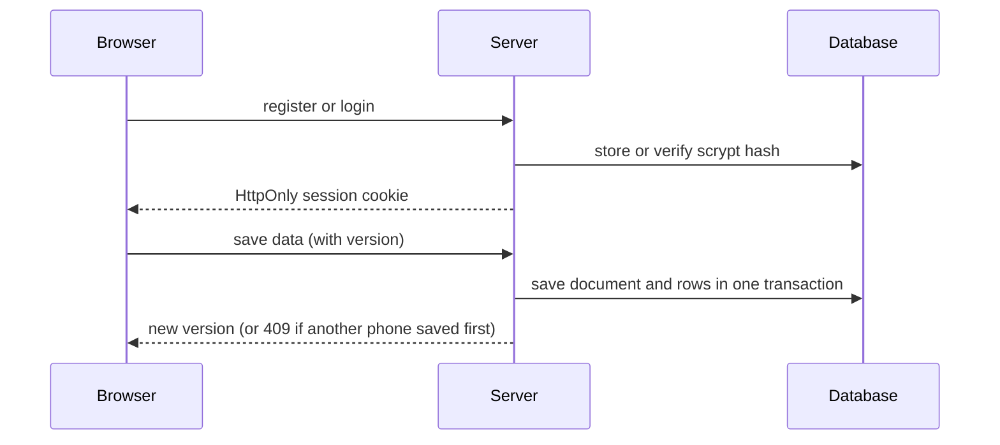

# TrueWage

**Platforms show what you earned. TrueWage shows what you actually made.**

[](https://github.com/Pegasus717/TrueWage/actions/workflows/ci.yml)

**Live demo:** https://truewage-0p3b.onrender.com/ (free host: the first load after idle can take up to a minute)

A delivery partner or cab driver uploads their earnings screenshots. TrueWage reads them with AI, subtracts petrol, repairs, mobile data, vehicle EMI and the time spent waiting, and shows what the rider really kept. Every rider has their own account, dashboard and history, in English, Hindi, Telugu or Tamil.


| Landing | Home | Check an order | Insights |
|---|---|---|---|
|  |  |  |  |

The numbers in these screenshots belong to a simulated demo rider and are labelled as such in the app.

## Contents
1. [Problem and solution](#1-problem-and-solution)
2. [Features](#2-features)
3. [Architecture](#3-architecture)
4. [Tech stack](#4-tech-stack)
5. [Getting started](#5-getting-started)
6. [Configuration](#6-configuration)
7. [How the numbers are calculated](#7-how-the-numbers-are-calculated)
8. [API](#8-api)
9. [Testing](#9-testing)
10. [Deployment](#10-deployment)
11. [Security and privacy](#11-security-and-privacy)
12. [Known limitations](#12-known-limitations)
13. [Project structure](#13-project-structure)
14. [Team](#14-team)

## 1. Problem and solution

**Problem.** Gig apps show one big earnings number. It ignores fuel, repairs, data, EMI, the ride to the next pickup and the hours spent waiting. Riders cannot see which hours or areas lose money, unions have no reliable data, and a rider has nothing to show a lender as income proof.

**Solution.** TrueWage turns screenshots into orders, applies the rider's real costs, and shows cash kept and real pay per hour against the fair-wage line. It also suggests when and where to work.

## 2. Features

| Area | What it does |
|---|---|
| Real earnings | Cash kept and real pay per hour, with a range that reflects how certain the cost assumptions are. |
| Screenshot reading | Claude vision reads any layout (order lists, trip details, daily totals, order offers). The rider reviews anything guessed before saving. On-device OCR is the fallback. |
| Daily use | Today card with goal progress, shift timer with GPS distance, order checker (take or skip), order-offer scanner, plan for the day. |
| Costs | Expense log; fuel fill-ups with odometer readings measure the real petrol cost per km. |
| Insights | Best day and time grid, best areas, weekly coach, what-if simulator. |
| Places | 42 Hyderabad and Bengaluru areas detected from addresses on screenshots or from GPS. |
| Accounts | Phone and password login, a private dashboard per rider, history, CSV export, account deletion. |
| Proof and city data | Tamper-evident income statement (SHA-256 and QR); anonymous city analytics shown only when 20 or more riders contributed. |
| Languages | English, Hindi, Telugu, Tamil; typed or spoken questions. |

## 3. Architecture

The front end is plain JavaScript with no build step and installs as a PWA. A small Python server handles login, storage and the AI calls. Data lives in Supabase PostgreSQL.



### How a screenshot becomes a result



To keep API use low, images are resized before upload and sent in batches. Each image is cached, so a repeat costs nothing. The cheaper model reads first, per-rider and per-day limits apply, and on-device OCR takes over when the AI is busy or the budget is used up.

### Data model

Each rider's rows are tied to their account and deleted with it.



Server-wide tables: `registry` (statement hashes), `contributions` (anonymous city data), `extract_cache`, `ai_budget`, `kv`. The schema is in [deploy/supabase_schema.sql](deploy/supabase_schema.sql) and is created automatically on start-up.

### Login and sync



The server identifies the rider only from the session cookie, never from the request body.

## 4. Tech stack

| Layer | Technology |
|---|---|
| Front end | JavaScript, HTML, CSS, PWA (service worker, share target) |
| Back end | Python 3 standard library (`server.py`, `accounts.py`, `store.py`) |
| Database | Supabase PostgreSQL (SQLite for local development) |
| AI | Claude vision for screenshots, Claude for grounded answers, Tesseract.js fallback |
| Hosting | Render (live), Docker Compose for Vultr or any VM |
| Quality | Node and Python tests, smoke test, GitHub Actions |

## 5. Getting started

Requirements: Python 3.9 or newer and a browser.

```bash
git clone https://github.com/Pegasus717/TrueWage.git
cd TrueWage
python server.py          # open http://localhost:8080
```

This uses a local SQLite file and the on-device reader. Open **Demo rider** for an instant tour, or create an account.

To use the AI reader and the online database:

```bash
pip install -r requirements.txt     # Postgres driver
cp .env.example .env                # then set ANTHROPIC_API_KEY and DATABASE_URL
python tools/db_check.py            # verifies the database (prints PASS or FAIL, never the password)
python server.py
```

Supabase setup is described in [deploy/SUPABASE.md](deploy/SUPABASE.md).

## 6. Configuration

All values are optional environment variables or entries in a git-ignored `.env` file.

| Variable | Default | Purpose |
|---|---|---|
| `DATABASE_URL` | none | Supabase connection string (Session pooler). Empty means local SQLite. |
| `ANTHROPIC_API_KEY` | none | Enables the AI reader. Stays on the server. |
| `TRUEWAGE_EXTRACT_MODEL` | `claude-haiku-5-5` | First-pass screenshot reader. |
| `TRUEWAGE_ESCALATE_MODEL` | `claude-sonnet-5-5` | Retries only images the first pass could not read. |
| `TRUEWAGE_MODEL` | `claude-haiku-5-5` | Answers to questions. |
| `TRUEWAGE_AI_DAILY_IMAGES` | `400` | Server-wide daily image cap. |
| `TRUEWAGE_AI_USER_DAILY` / `TRUEWAGE_AI_USER_ASKS` | `60` / `100` | Per-rider daily limits. |
| `TRUEWAGE_ADMIN_PHONES` | none | Phone numbers allowed to open the Admin overview. |
| `TRUEWAGE_TRUST_PROXY` | `0` | Set to `1` behind an HTTPS proxy. |
| `PORT` | `8080` | Listen port. |

## 7. How the numbers are calculated

```
gross             = pay + incentives + bonus share - platform deductions
fuel              = (paid km + unpaid km) x petrol cost per km
repairs and other = (paid km + unpaid km) x rate, or the real logged repairs
mobile data       = online hours x data cost per hour
cash remaining    = gross - fuel - repairs - data - EMI
real pay per hour = cash remaining / online hours (waiting included)
```

- Unpaid distance is measured from GPS shifts once three are matched with screenshots; until then it is an editable assumption.
- Petrol cost per km is measured from fill-ups with odometer readings once two intervals exist.
- A long gap in the data counts as at most three days, so one old screenshot cannot create months of EMI.
- Defaults such as mileage, fuel price and the Rs 90 per hour fair-wage line are editable assumptions, not sourced statistics.

## 8. API

| Endpoint | Purpose |
|---|---|
| `POST /api/auth/register`, `/login`, `/logout` | Account and session |
| `GET /api/me`, `PUT /api/me/data` | Profile and the rider's saved data |
| `GET /api/me/history`, `GET /api/me/export.csv` | History and CSV export |
| `POST /api/extract` | Read screenshots with AI |
| `POST /api/ask` | Answer a question from the rider's numbers |
| `POST /api/statement`, `GET /api/statement/<id>` | Register and verify an income statement |
| `POST /api/contribute`, `GET /api/city` | Anonymous city data |
| `GET /api/health` | Status (never returns secrets) |

State-changing requests need the `X-TW: 1` header and a matching origin.

## 9. Testing

```bash
node tests/engine.test.js                    # calculation engine, readers, places, expenses
python -m unittest discover -s tests         # server and accounts (runs on local SQLite)
python tools/db_check.py                     # end-to-end check of the configured database
python tools/smoke.py https://your-site      # 33 checks against a running deployment
python tools/accuracy_eval.py                # accuracy of the AI reader on your own screenshots
```

The AI path is tested against a local mock of the Claude API. The live reader has been spot-checked on a small set of real screenshots; `tools/accuracy_eval.py` measures it on a larger set you provide (see `tests/real/README.md`).

## 10. Deployment

- **Render (live):** `render.yaml` and [deploy/RENDER.md](deploy/RENDER.md).
- **Docker or a VM (for example Vultr):** `Dockerfile`, `docker-compose.yml` with automatic HTTPS, and [deploy/VULTR.md](deploy/VULTR.md). These files are written but have not been run on a Vultr server.
- **Database:** Supabase PostgreSQL ([deploy/SUPABASE.md](deploy/SUPABASE.md)).

## 11. Security and privacy

- Passwords are stored as scrypt hashes; session tokens only as SHA-256 hashes; cookies are `HttpOnly`, `SameSite=Strict` and `Secure` over HTTPS.
- Login is rate-limited; state-changing requests are CSRF-protected; uploads are validated for type, size and content.
- Every database table has Row Level Security enabled and no access for Supabase's public roles. Only the server connects.
- The API key and database URL stay on the server and are git-ignored.
- Screenshots are not written to disk. The AI is told to return area names only, never names, phone numbers or exact addresses.
- City sharing is opt-in and anonymous.

## 12. Known limitations

- Phone and password login with no SMS or e-mail verification; a forgotten password cannot be recovered.
- AI reading accuracy is spot-checked on a small sample, not measured at scale. Every import ends in a review step.
- City analytics in the demo are simulated; live results appear only after 20 real contributors.
- GPS tracking, voice input and the share-from-gallery feature were tested in a desktop browser, not on a real phone.
- The income statement is rider-reported and tamper-evident, not certified by a platform or bank.

## 13. Project structure

```
index.html, css/, manifest.json, sw.js   web app shell (installable PWA)
js/engine.js     calculation engine (pure, unit-tested)
js/reader.js     screenshot reader client and on-device OCR
js/places.js     place detection from addresses and GPS
js/app.js        screens, account sync, shift tracker
js/ask.js, i18n.js, demo.js   offline questions, four languages, demo data
server.py        HTTP API, static files, AI brokering, rate limits
accounts.py      users, sessions, per-rider data, history, export, quotas
store.py         storage layer (Supabase PostgreSQL or SQLite)
tests/, tools/   tests, smoke test, database check, accuracy tool
deploy/          Render, Supabase, Docker and Vultr guides
docs/screens/    app screenshots
```

## 14. Team

| Name | GitHub |
|---|---|
| Raghuram | [Pegasus717](https://github.com/Pegasus717) |
| Santosh | [wildwolf06](https://github.com/wildwolf06) |
