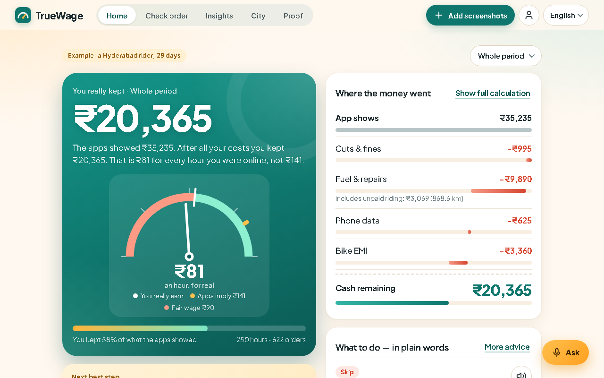
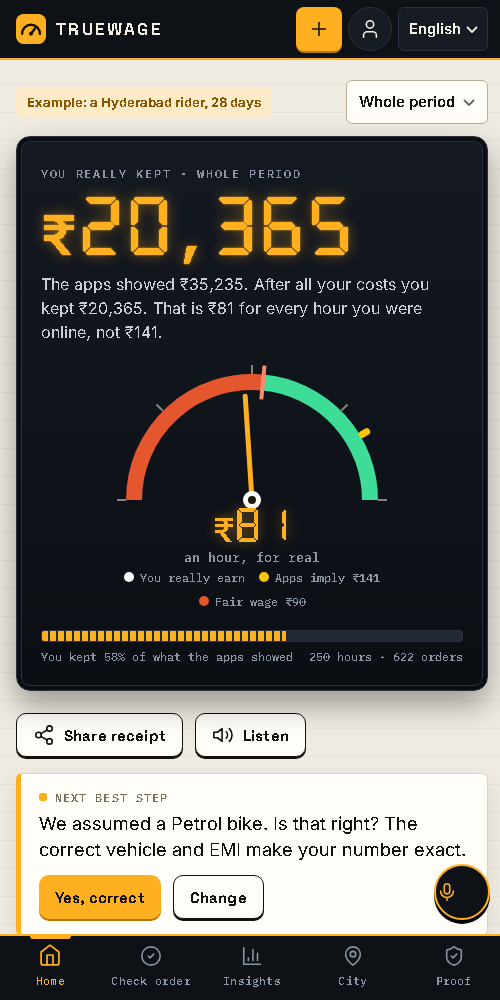
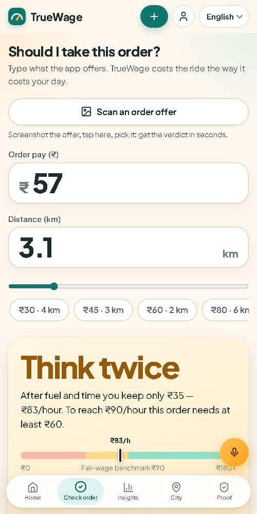
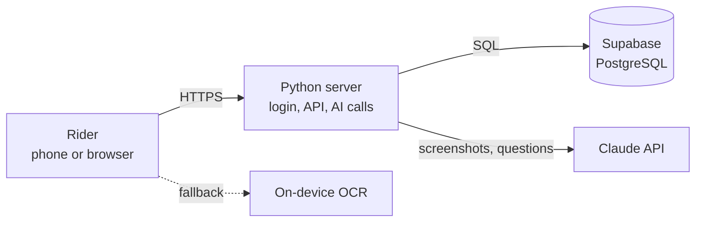
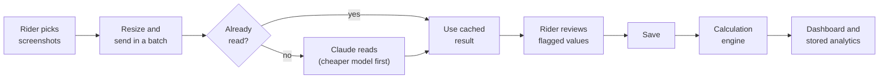
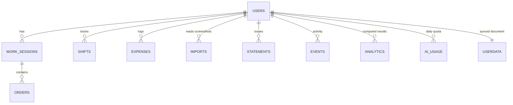

# TrueWage

**Platforms show what you earned. TrueWage shows what you actually made.**

[](https://github.com/Pegasus717/TrueWage/actions/workflows/ci.yml)

**Live demo:** https://truewage-0p3b.onrender.com/
The site runs on free hosting, so the first load after a quiet period can take up to a minute.

TrueWage helps delivery partners and cab drivers find out what they really earn. The rider uploads earnings screenshots from apps such as Swiggy, Zomato, Rapido or Ola. TrueWage reads them with AI, subtracts petrol, repairs, mobile data, vehicle EMI and waiting time, and shows the amount the rider actually kept and their real pay per hour.



**Jump to:** [Overview](#overview) · [Features](#features) · [Architecture](#architecture) · [Tech stack](#tech-stack) · [Getting started](#getting-started) · [Configuration](#configuration) · [Testing](#testing) · [Deployment](#deployment) · [Security](#security-and-privacy) · [Limitations](#limitations) · [Team](#team)

---

## Overview

### The problem

Gig-work apps show a single earnings figure. It does not include fuel, repairs, mobile data, the vehicle EMI, the ride to the next pickup or the hours spent waiting for orders. As a result:

- Riders cannot tell which hours, areas or apps lose them money.
- Unions and researchers have no reliable data on real pay.
- Riders have no income proof when they apply for a loan.

### The solution

TrueWage turns screenshots into structured orders, applies the rider's real costs, and shows the result against a fair-wage line. It then advises the rider on when and where to work, and gives them a verifiable income statement.

### Screenshots

| Home | Check an order | Insights |
|---|---|---|
|  |  |  |

The numbers shown belong to a simulated demo rider and are labelled that way in the app.

---

## Features

| Feature | Description |
|---|---|
| Real earnings | Shows cash kept and real pay per hour, with a range that reflects how certain the cost assumptions are. |
| Screenshot reading | Claude vision reads order lists, trip details, daily totals and order offers in any layout. The rider reviews anything uncertain before saving. On-device OCR is the fallback. |
| Shift tracking | Records online hours and distance by GPS, including unpaid kilometres, and names the area the rider worked in. |
| Expense log | Fuel fill-ups with odometer readings measure the real petrol cost per km. Repairs, tolls and fines are counted once. |
| Order checker | Tells the rider whether a new order is worth taking. An offer screenshot can be scanned instead of typed. |
| Insights | Best days, times and areas, a plan for the day, a weekly summary and a what-if simulator. |
| Accounts | Phone and password login, a private dashboard per rider, history, CSV export and account deletion. |
| Income statement | A printable statement with a SHA-256 hash and QR code, so a lender can check it was not altered. |
| City data | Anonymous pay data by area and time, shown only when at least 20 riders have contributed. |
| Languages | English, Hindi, Telugu and Tamil, with typed or spoken questions. |

---

## Architecture

TrueWage has three parts: a browser app, a Python server, and a hosted database. The server also calls the Claude API.



| Component | Responsibility |
|---|---|
| Browser app (`js/`) | Screens, the calculation engine, the on-device reader and the offline cache. |
| Server (`server.py`, `accounts.py`) | Login and sessions, the API, rate limits, and the calls to Claude. The API key never reaches the browser. |
| Storage layer (`store.py`) | One interface for Supabase PostgreSQL in production and SQLite for local development. |
| Database | Accounts, each rider's data and history, analytics, and the AI reading cache. |

### From screenshot to result



To keep API use low, images are resized before upload and sent in batches. Each image is cached, so a repeat costs nothing. The cheaper model reads first, and the stronger one is used only for images it could not read. Per-rider and per-day limits apply, and on-device OCR takes over when the AI is busy or the budget is used up.

### Data model

Each rider's rows are tied to their account and are deleted with it.



The full schema is in [deploy/supabase_schema.sql](deploy/supabase_schema.sql). More detail on the login flow, calculations and API is in [docs/architecture.md](docs/architecture.md).

---

## Tech stack

| Layer | Technology | Used for |
|---|---|---|
| Front end | JavaScript, HTML, CSS | The web app, with no build step |
| Front end | Progressive Web App (service worker) | Installing on a phone, offline use, receiving shared screenshots |
| Front end | Tesseract.js | On-device OCR when the AI is unavailable |
| Back end | Python 3 (standard library) | HTTP server, login, API, rate limiting |
| AI | Claude API (vision and text) | Reading screenshots and answering questions |
| Database | Supabase PostgreSQL | Accounts, rider data, history, analytics, cache |
| Database | SQLite | Local development and tests |
| Hosting | Render | The live site |
| Containers | Docker, Docker Compose, Caddy | Running on any server with automatic HTTPS |
| Quality | Node.js and Python `unittest`, GitHub Actions | Tests and continuous integration |

---

## Project structure

```
index.html, css/, manifest.json, sw.js    Web app shell (installable PWA)
js/
  engine.js      Calculation engine (pure functions, unit-tested)
  reader.js      Screenshot reader client and on-device OCR
  places.js      Place detection from addresses and GPS
  app.js         Screens, account sync, shift tracker
  ask.js, i18n.js, demo.js    Offline questions, four languages, demo data
server.py        HTTP API, static files, AI calls, rate limits
accounts.py      Users, sessions, per-rider data, history, export, quotas
store.py         Storage layer (Supabase PostgreSQL or SQLite)
tests/           Engine, server and account tests
tools/           Smoke test, database check, accuracy evaluation
deploy/          Render, Supabase, Docker and Vultr guides
docs/            Screenshots and architecture notes
```

---

## Getting started

**Requirements:** Python 3.9 or newer and a web browser.

### Run locally

```bash
git clone https://github.com/Pegasus717/TrueWage.git
cd TrueWage
python server.py
```

Open http://localhost:8080. This uses a local SQLite file and the on-device reader. Press **Demo rider** for a quick tour, or create an account.

### Use the AI reader and the online database

```bash
pip install -r requirements.txt
cp .env.example .env
```

Edit `.env` and set `ANTHROPIC_API_KEY` and `DATABASE_URL`, then check the database and start the server:

```bash
python tools/db_check.py
python server.py
```

`db_check.py` prints PASS or FAIL for each check and never shows the password. Supabase setup is described in [deploy/SUPABASE.md](deploy/SUPABASE.md).

---

## Configuration

Settings are environment variables, or entries in a `.env` file that Git ignores. All of them are optional.

| Variable | Default | Purpose |
|---|---|---|
| `DATABASE_URL` | empty | Supabase connection string (Session pooler). Empty means a local SQLite file. |
| `ANTHROPIC_API_KEY` | empty | Enables the AI reader. It stays on the server. |
| `TRUEWAGE_EXTRACT_MODEL` | `claude-haiku-5-5` | Model that reads screenshots first. |
| `TRUEWAGE_ESCALATE_MODEL` | `claude-sonnet-5-5` | Model used only for images the first one could not read. |
| `TRUEWAGE_MODEL` | `claude-haiku-5-5` | Model that answers questions. |
| `TRUEWAGE_AI_DAILY_IMAGES` | `400` | Server-wide daily limit on images read by the AI. |
| `TRUEWAGE_AI_USER_DAILY` | `60` | Images one rider can have read per day. |
| `TRUEWAGE_AI_USER_ASKS` | `100` | Questions one rider can ask per day. |
| `TRUEWAGE_ADMIN_PHONES` | empty | Phone numbers allowed to open the Admin overview. |
| `TRUEWAGE_TRUST_PROXY` | `0` | Set to `1` when running behind an HTTPS proxy. |
| `PORT` | `8080` | Port the server listens on. |

---

## How the numbers are calculated

```
gross             = pay + incentives + bonus share - platform deductions
fuel              = (paid km + unpaid km) x petrol cost per km
repairs and other = (paid km + unpaid km) x rate, or the real logged repairs
mobile data       = online hours x data cost per hour
cash remaining    = gross - fuel - repairs - data - EMI
real pay per hour = cash remaining / online hours   (waiting time included)
```

- Unpaid distance comes from GPS shifts once three are matched with screenshots. Until then it is an editable assumption.
- Petrol cost per km comes from fill-ups with odometer readings once two intervals exist.
- A long gap in the data counts as at most three days, so one old screenshot cannot create months of EMI.
- Defaults such as mileage, fuel price and the Rs 90 per hour fair-wage line are editable assumptions, not sourced statistics.

---

## Testing

```bash
node tests/engine.test.js                    # calculation engine, readers, place detection
python -m unittest discover -s tests         # server and accounts (runs on local SQLite)
python tools/db_check.py                     # end-to-end check of the configured database
python tools/smoke.py https://your-site      # checks a running deployment
python tools/accuracy_eval.py                # measures the AI reader on your own screenshots
```

The server tests run against a local mock of the Claude API, so they never spend API credit. `tools/accuracy_eval.py` measures how accurate the live AI reader is on a set of screenshots you provide, as described in `tests/real/README.md`.

---

## Deployment

| Option | Details |
|---|---|
| Render (live site) | `render.yaml` and [deploy/RENDER.md](deploy/RENDER.md) |
| Any server with Docker | `Dockerfile` and `docker-compose.yml` with automatic HTTPS, described in [deploy/VULTR.md](deploy/VULTR.md). These files have not yet been run on a Vultr server. |
| Database | Supabase PostgreSQL, see [deploy/SUPABASE.md](deploy/SUPABASE.md) |

---

## Security and privacy

- Passwords are stored as scrypt hashes. Session tokens are stored only as hashes and sent in `HttpOnly`, `SameSite=Strict` cookies (`Secure` over HTTPS).
- Login attempts are rate-limited, and requests that change data are protected against CSRF.
- Every database table has Row Level Security enabled with no access for Supabase's public roles. Only the server connects to the database.
- The API key and database URL stay on the server and are excluded from Git.
- Screenshots are not saved to disk. The AI is told to return area names only, never names, phone numbers or exact addresses.
- City sharing is optional and anonymous.

---

## Limitations

- Login uses a phone number and password with no SMS or e-mail check, so a forgotten password cannot be recovered.
- The AI reader has been spot-checked on a small set of screenshots, not measured at scale. Every import ends with a review step.
- City analytics in the demo are simulated.
- GPS, voice input and sharing from the phone gallery were tested in a desktop browser, not on a real phone.
- The income statement is reported by the rider and protected against tampering. It is not certified by a platform or a bank.

---

## Team

| Name | GitHub |
|---|---|
| Raghuram | [Pegasus717](https://github.com/Pegasus717) |
| Santosh | [wildwolf06](https://github.com/wildwolf06) |
