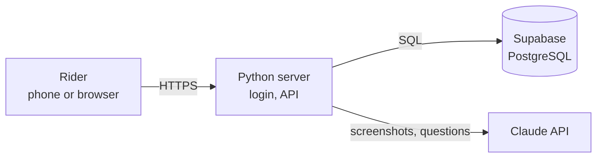

# TrueWage

**Platforms show what you earned. TrueWage shows what you actually made.**

[](https://github.com/Pegasus717/TrueWage/actions/workflows/ci.yml)

**Live demo:** https://truewage-0p3b.onrender.com/ (free hosting: the first load after a quiet period can take up to a minute)

A delivery partner or cab driver uploads earnings screenshots. TrueWage reads them with AI, subtracts petrol, repairs, mobile data, vehicle EMI and waiting time, and shows what the rider really kept. Every rider has a private account, dashboard and history, in English, Hindi, Telugu or Tamil.


| Home | Check an order | Insights |
|---|---|---|
|  |  |  |

The numbers above belong to a simulated demo rider, and the app labels them that way.

## The problem

Gig apps show one big earnings number. It leaves out fuel, repairs, data, EMI and the hours spent waiting for orders. Riders cannot see which hours or areas lose money, and they have nothing to show a lender as income proof.

## What it does

- Shows **cash kept** and **real pay per hour** next to the fair-wage line.
- Reads earnings screenshots and order offers in any layout; the rider reviews anything uncertain before saving.
- Tracks shifts with GPS and logs fuel and other expenses, so costs come from real data.
- Advises on the best days, times and areas, and checks any new order (take or skip).
- Keeps each rider's data, history and analytics in their own account, with CSV export.
- Creates a tamper-evident income statement for lenders.

## How it works


## Architecture



- **Front end:** plain JavaScript, installable as a PWA. All calculations run in one tested module (`js/engine.js`).
- **Back end:** a small Python server for login, storage and the AI calls. The API key never reaches the browser.
- **Database:** Supabase PostgreSQL holds accounts, each rider's data and history, analytics, and the AI cache.
- **AI:** the cheaper Claude model reads first, results are cached per image, and per-rider limits keep cost low. On-device OCR is the fallback.

The data model, login flow, formulas and API are described in [docs/architecture.md](docs/architecture.md).

## Tech stack

JavaScript (no build step) · Python 3 standard library · Supabase PostgreSQL · Claude API · Tesseract.js · Docker · GitHub Actions

## Run it locally

```bash
git clone https://github.com/Pegasus717/TrueWage.git
cd TrueWage
python server.py        # open http://localhost:8080
```

This uses a local SQLite file. Press **Demo rider** for a quick tour, or create an account.

To use the AI reader and the online database:

```bash
pip install -r requirements.txt
cp .env.example .env    # set ANTHROPIC_API_KEY and DATABASE_URL
python tools/db_check.py
python server.py
```

Supabase setup: [deploy/SUPABASE.md](deploy/SUPABASE.md).

## Configuration

| Variable | Purpose |
|---|---|
| `DATABASE_URL` | Supabase connection string. Leave empty to use a local SQLite file. |
| `ANTHROPIC_API_KEY` | Enables the AI reader. Stays on the server. |
| `TRUEWAGE_ADMIN_PHONES` | Phone numbers allowed to open the Admin overview. |
| `TRUEWAGE_TRUST_PROXY` | Set to `1` behind an HTTPS proxy. |

All options, including model names and daily limits, are listed in `.env.example`.

## Tests

```bash
node tests/engine.test.js                    # calculation engine, readers, places
python -m unittest discover -s tests         # server and accounts
python tools/smoke.py https://your-site      # checks a running deployment
python tools/accuracy_eval.py                # measures the AI reader on your own screenshots
```

## Deployment

The live site runs on Render with Supabase as the database ([deploy/RENDER.md](deploy/RENDER.md)). A `Dockerfile` and `docker-compose.yml` with automatic HTTPS are included for any server, such as Vultr ([deploy/VULTR.md](deploy/VULTR.md)); these have not yet been run on a Vultr server.

## Security

Passwords are stored as scrypt hashes and sessions as hashed tokens in `HttpOnly` cookies. Login is rate-limited and writes are CSRF-protected. Database tables use Row Level Security, and only the server connects to them. Screenshots are never stored on disk.

## Known limitations

- Login uses a phone number and password with no SMS or e-mail check, so a forgotten password cannot be recovered.
- The AI reader has been spot-checked on a small set of screenshots, not measured at scale. Every import ends with a review step.
- City analytics in the demo are simulated.
- GPS, voice input and sharing from the phone gallery were tested in a desktop browser, not on a real phone.

## Team

| Name | GitHub |
|---|---|
| Raghuram | [Pegasus717](https://github.com/Pegasus717) |
| Santosh | [wildwolf06](https://github.com/wildwolf06) |
