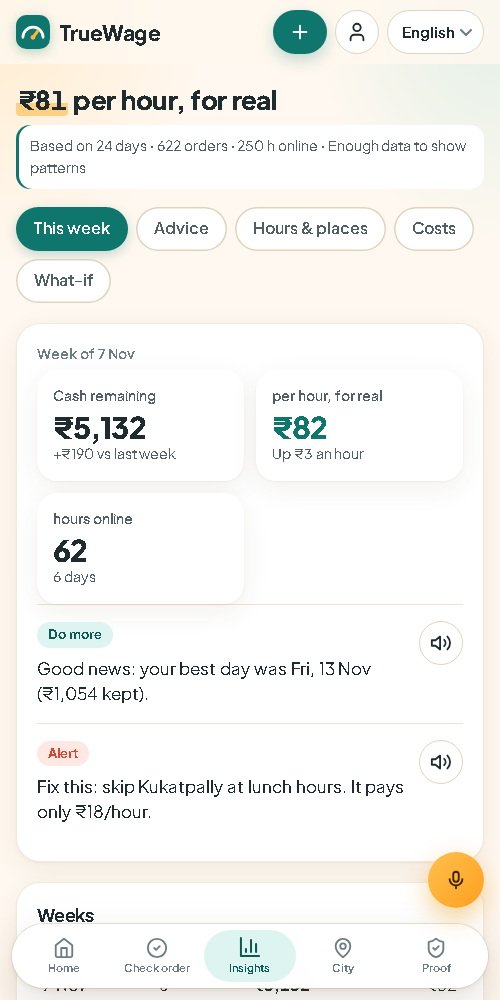
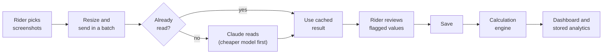
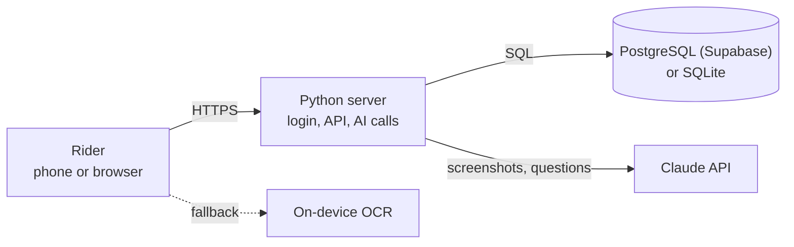
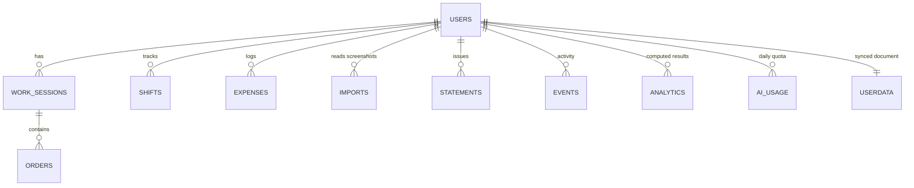

# TrueWage

**Platforms show what you earned. TrueWage shows what you actually made.**

[](https://github.com/Pegasus717/TrueWage/actions/workflows/ci.yml)

| | |
|---|---|
| **Live demo (Vultr)** | https://65-20-93-226.sslip.io/ |
| **Source code** | https://github.com/Pegasus717/TrueWage |
| **Architecture** | [Overview below](#architecture) · [docs/architecture.md](docs/architecture.md) |
| **Run it yourself** | [Getting started](#getting-started) |

TrueWage helps delivery partners and cab drivers find out what they really earn. The rider uploads earnings screenshots from apps such as Swiggy, Zomato, Rapido or Ola. TrueWage reads them with AI, subtracts petrol, repairs, mobile data, vehicle EMI and waiting time, and shows the amount the rider actually kept and their real pay per hour.


---

## Overview

**The problem.** Gig-work apps show a single earnings figure. It leaves out fuel, repairs, mobile data, the vehicle EMI, the ride to the next pickup and the hours spent waiting for orders. So:

- Riders cannot tell which hours, areas or apps lose them money.
- Unions and researchers have no reliable data on real pay.
- Riders have no income proof when they apply for a loan.

**The solution.** TrueWage turns screenshots into structured orders, applies the rider's real costs and shows the result against a fair-wage line. It then advises the rider on when and where to work, and produces a verifiable income statement.

| Home | Check an order | Insights |
|---|---|---|
|  |  |  |

The numbers in these screenshots belong to a simulated demo rider and are labelled that way in the app.

---

## Features

### Know what you earn

| Feature | What it does |
|---|---|
| Real earnings | Cash kept and real pay per hour, with a range that reflects how certain the cost assumptions are. |
| Screenshot reading | Claude vision reads order lists, trip details, daily totals and order offers in any layout. The rider reviews anything uncertain before saving. On-device OCR is the fallback. |
| Vehicle costs | Owned or rented vehicle, loan EMI, insurance, rent, traffic and load, and tyre, oil and battery wear. A bicycle costs nothing per km. |
| Shift tracking | Online hours and distance from GPS, including unpaid kilometres, with the area worked. |
| Expense log | Fuel fill-ups with odometer readings measure the real petrol cost per km. Repairs, tolls and fines are counted once. |
| Service reminder | Kilometres left before the next service, from odometer readings. |

### Decide and plan

| Feature | What it does |
|---|---|
| Order checker | Tells the rider whether a new order is worth taking. An offer screenshot can be scanned instead of typed. |
| Insights | Best days, times and areas, a plan for the day, a weekly summary and a what-if simulator. |
| Weeks and months | Every week and month with what the apps showed, what was cut, what the rider kept, and the change from the period before. |
| App comparison | Real pay per hour on each app with an 80% range from the rider's own days, and which app pays best at each time of day. |
| City data | Anonymous pay by area and time, shown only when at least 20 riders have contributed. |

### Trust and records

| Feature | What it does |
|---|---|
| Payout check | The rider enters what an app paid for a period. TrueWage compares it with the rider's own order records for the same app and dates and flags a gap. |
| Edit records | Fix a day, split or merge days, or remove the last import, with undo. Edits sync between devices and deletions stay deleted. |
| Income statement | A printable A4 statement for a lender: month-by-month income, typical and weakest month, the EMI the income can carry, where the records came from, and a SHA-256 hash with a QR code and a public verification page. |
| Reading accuracy | Counts the values riders corrected after each reading, so the accuracy of the AI reader and of on-device OCR is measured from real use. |

### Accounts and operations

| Feature | What it does |
|---|---|
| Accounts | Phone and password login, a private dashboard, history, CSV export and account deletion. A one-time recovery code resets a forgotten password, and one tap logs out every other device. |
| Languages | English, Hindi, Telugu, Tamil, Kannada, Marathi and Bengali, with typed or spoken questions. |
| Operations | Versioned database migrations, scheduled backups with a restore drill, health and readiness checks, request metrics, an error log and an admin System panel. |

---

## How it works



To keep AI use low, images are resized before upload and sent in batches, and every image is cached so a repeat costs nothing. The cheaper model reads first and the stronger one is used only for images it could not read. Per-rider and per-day limits apply, and on-device OCR takes over when the AI is busy or the budget is used up.

### How the numbers are calculated

```
gross             = pay + incentives + bonus share - platform deductions
fuel              = (paid km + unpaid km) x petrol cost per km
repairs and other = (paid km + unpaid km) x rate, or the real logged repairs
                    (rate = one figure, or tyres + oil + battery + small parts; 0 on a rented vehicle)
mobile data       = online hours x data cost per hour
cash remaining    = gross - fuel - repairs - data - EMI
real pay per hour = cash remaining / online hours   (waiting time included)
```

- Unpaid distance comes from GPS shifts once three are matched with screenshots. Until then it is an editable assumption.
- Petrol cost per km comes from fill-ups with odometer readings once two intervals exist.
- A long gap in the data counts as at most three days, so one old screenshot cannot create months of EMI.
- Fixed costs per day are loan EMI / 30 plus insurance / 365 for an owned vehicle, or the daily rent for a rented one, plus any other fixed cost the rider enters.
- Traffic and load raise the fuel estimate by up to 12% (and lower it by 8% in light traffic). A measured petrol cost from fill-ups is never scaled.
- The range on the app comparison is the 10th to 90th percentile of 400 resamples of the rider's own working days.
- Defaults such as mileage, fuel price and the Rs 90 per hour fair-wage line are editable assumptions, not sourced statistics.

---

## Architecture

TrueWage has three parts: a browser app, a Python server and a database. The server also calls the Claude API.



| Component | Responsibility |
|---|---|
| Browser app (`js/`) | Screens, the calculation engine, the on-device reader and the offline cache. |
| Server (`server.py`, `accounts.py`) | Login and sessions, the API, rate limits and the calls to Claude. The API key never reaches the browser. |
| Storage layer (`store.py`) | One interface for Supabase PostgreSQL in production and SQLite for local runs and the Vultr demo. |
| Operations (`backup.py`, `monitor.py`) | Backups, request metrics, the error log and the readiness check. |

### Data model

Each rider's rows are tied to their account and are deleted with it.



The full schema is in [deploy/supabase_schema.sql](deploy/supabase_schema.sql). More on the login flow, calculations and API is in [docs/architecture.md](docs/architecture.md).

---

## Tech stack

| Layer | Technology | Used for |
|---|---|---|
| Front end | JavaScript, HTML, CSS (no build step) | The web app |
| Front end | Progressive Web App, service worker | Installing on a phone, offline use, receiving shared screenshots |
| Front end | Tesseract.js | On-device OCR when the AI is unavailable |
| Back end | Python 3 (standard library) | HTTP server, login, API, rate limiting |
| AI | Claude API (vision and text) | Reading screenshots and answering questions |
| Database | Supabase PostgreSQL · SQLite | Production data · local runs, tests and the Vultr demo |
| Hosting | **Vultr Cloud Compute** · Render | The live demo · a second deployment with the hosted database |
| Containers | Docker, Docker Compose, Caddy | Running on any server with automatic HTTPS |
| Quality | Node.js, Python `unittest`, GitHub Actions | 106 Python tests plus engine, merge and language tests, and CI |

---

## Getting started

**Requirements:** Python 3.9 or newer and a web browser.

### Run locally

```bash
git clone https://github.com/Pegasus717/TrueWage.git
cd TrueWage
python server.py
```

Open http://localhost:8080. This uses a local SQLite file and the on-device reader. Press **Demo rider** for a quick tour, or create an account.

### Use the AI reader and the online database

```bash
pip install -r requirements.txt
cp .env.example .env
```

Edit `.env` and set `ANTHROPIC_API_KEY` and `DATABASE_URL`, then check the database and start the server:

```bash
python tools/db_check.py
python server.py
```

`db_check.py` prints PASS or FAIL for each check and never shows the password. Supabase setup is in [deploy/SUPABASE.md](deploy/SUPABASE.md).

---

## Configuration

Settings are environment variables, or entries in a `.env` file that Git ignores. All of them are optional.

| Variable | Default | Purpose |
|---|---|---|
| `DATABASE_URL` | empty | Supabase connection string (Session pooler). Empty means a local SQLite file. |
| `ANTHROPIC_API_KEY` | empty | Enables the AI reader. It stays on the server. |
| `TRUEWAGE_EXTRACT_MODEL` | `claude-haiku-5-5` | Model that reads screenshots first. |
| `TRUEWAGE_ESCALATE_MODEL` | `claude-sonnet-5-5` | Model used only for images the first one could not read. |
| `TRUEWAGE_MODEL` | `claude-haiku-5-5` | Model that answers questions. |
| `TRUEWAGE_AI_DAILY_IMAGES` | `400` | Server-wide daily limit on images read by the AI. |
| `TRUEWAGE_AI_USER_DAILY` | `60` | Images one rider can have read per day. |
| `TRUEWAGE_AI_USER_ASKS` | `100` | Questions one rider can ask per day. |
| `TRUEWAGE_ADMIN_PHONES` | empty | Phone numbers allowed to open the Admin overview. |
| `TRUEWAGE_TRUST_PROXY` | `0` | Set to `1` when running behind an HTTPS proxy. |
| `TRUEWAGE_LOG` | `1` | One JSON log line per API request (route, status, milliseconds; no phone numbers, IPs or bodies). `0` turns it off. |
| `TRUEWAGE_METRICS_TOKEN` | empty | Lets an uptime or metrics service read `/api/metrics` with `Authorization: Bearer <token>`. Admin riders can always read it. |
| `TRUEWAGE_BACKUP_DIR` | empty | Folder for scheduled backups. SQLite defaults to `data/backups`; with PostgreSQL nothing is written to the web server unless this is set. |
| `TRUEWAGE_BACKUP_EVERY_H`, `TRUEWAGE_BACKUP_KEEP` | `24`, `7` | Hours between scheduled backups and how many files to keep. |
| `PORT` | `8080` | Port the server listens on. |

---

## Testing

```bash
node tests/engine.test.js                    # calculation engine, readers, place detection
node tests/merge.test.js                     # two-device merge rules (edits and deletions)
python -m unittest discover -s tests         # server, accounts, migrations, backups, monitoring (local SQLite)
python tools/db_check.py                     # end-to-end check of the configured database
python tools/smoke.py https://your-site      # checks a running deployment
python tools/accuracy_eval.py                # measures the AI reader on your own screenshots
```

The server tests run against a local mock of the Claude API, so they never spend API credit. `tools/accuracy_eval.py` measures the live AI reader on screenshots you provide, as described in `tests/real/README.md`.

---

## Deployment

| Target | Details |
|---|---|
| **Vultr Cloud Compute (live demo)** | A Mumbai server (1 vCPU, 2 GB, Ubuntu 24.04) set up by the first-boot script [deploy/vultr-startup.sh](deploy/vultr-startup.sh). It installs Docker, pulls this repository and runs `docker-compose.yml` with Caddy, which gets an HTTPS certificate for a free `<ip>.sslip.io` name. The same files run on any Docker host; see [deploy/VULTR.md](deploy/VULTR.md). |
| Render | A second deployment with the AI reader and the Supabase database: `render.yaml` and [deploy/RENDER.md](deploy/RENDER.md). |
| Database | Supabase PostgreSQL: [deploy/SUPABASE.md](deploy/SUPABASE.md). |
| Backups and uptime | `.github/workflows/backup.yml` (daily encrypted dump) and `uptime.yml` (readiness check of both sites every 10 minutes). See [docs/architecture.md](docs/architecture.md#backups-migrations-and-monitoring). |

---

## Security and privacy

- Passwords and recovery codes are stored as scrypt hashes. A recovery code is 100 random bits, shown once and replaced each time it is used.
- Session tokens are stored only as hashes and sent in `HttpOnly`, `SameSite=Strict` cookies (`Secure` over HTTPS).
- Login attempts are rate-limited, and requests that change data are protected against CSRF.
- Every database table has Row Level Security enabled with no access for Supabase's public roles. Only the server connects to the database.
- The API key and database URL stay on the server and are excluded from Git.
- Screenshots are not saved to disk. The AI is told to return area names only, never names, phone numbers or exact addresses.
- Backups contain password hashes and phone numbers. The scheduled workflow encrypts them before upload; the admin download and `python backup.py dump` produce plain files that must be kept private.
- Error logs hold only a short message with long digit runs and URLs removed, the route and a request id.
- City sharing is optional and anonymous.

---

## Limitations

- Login has no SMS or e-mail check. A forgotten password is reset with the recovery code shown at sign-up; a rider who loses both cannot get back in.
- The AI reader has been spot-checked on a small set of screenshots. Its accuracy is measured from rider corrections, and no figure is published until riders have checked at least 100 values. Every import ends with a review step.
- City analytics in the demo are simulated. The income statement is reported by the rider and protected against tampering, but it is not certified by a platform or a bank.
- The Vultr and Render deployments are separate: accounts and data are not shared, and the Vultr copy reads screenshots on the device because no AI key is set there.
- GPS, voice input and gallery sharing have been tested in a desktop browser, not yet on a real phone. The Kannada, Marathi and Bengali screens have not been reviewed by native speakers.

---

## Future scope

- **Lender-ready statements:** let banks and NBFCs verify a statement through an API, and add a short-form summary for loan applications.
- **More languages:** Gujarati, Malayalam, Punjabi and Odia, with review by native speakers.
- **Direct platform data:** import payout CSVs and statement e-mails so riders can skip screenshots.
- **Stronger sign-in:** optional SMS or e-mail recovery.
- **Native Android app:** background shift tracking that keeps running with the screen off.
- **Pay transparency for researchers and unions:** city and area reports built on the existing anonymous data, once enough riders have joined.
- **Published accuracy:** release the AI reader's measured accuracy after enough rider-checked values.
- **Custom domain:** a permanent web address in place of the IP-based name.

---

## Project structure

```
index.html, css/, manifest.json, sw.js    Web app shell (installable PWA)
js/
  engine.js      Calculation engine (pure functions, unit-tested)
  reader.js      Screenshot reader client and on-device OCR
  places.js      Place detection from addresses and GPS
  app.js         Screens, account sync, shift tracker
  ask.js, i18n.js, demo.js    Offline questions, seven languages, demo data
server.py        HTTP API, static files, AI calls, rate limits
accounts.py      Users, sessions, per-rider data, history, export, quotas
store.py         Storage layer (Supabase PostgreSQL or SQLite)
backup.py        Database dump, verify, restore drill and scheduled backups
monitor.py       Request metrics, error log and readiness check
tests/           Engine, merge, server, account, backup and monitoring tests
tools/           Smoke test, database check, accuracy evaluation
deploy/          Vultr, Render, Supabase and Docker guides
docs/            Screenshots and architecture notes
```

---

## Team

| Name | GitHub |
|---|---|
| Raghuram | [Pegasus717](https://github.com/Pegasus717) |
| Santosh | [wildwolf06](https://github.com/wildwolf06) |
