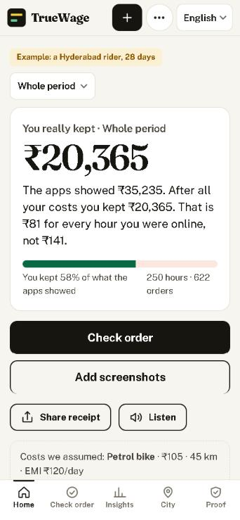
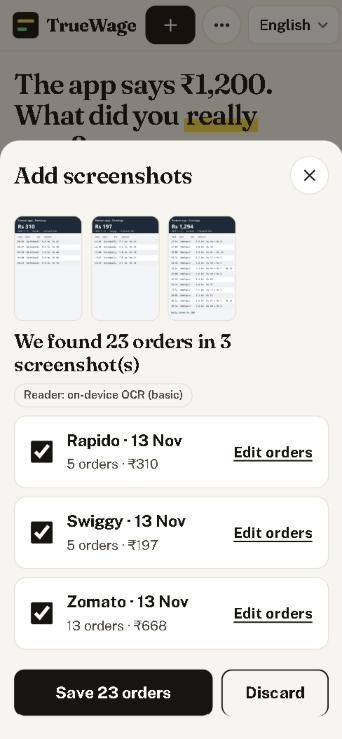
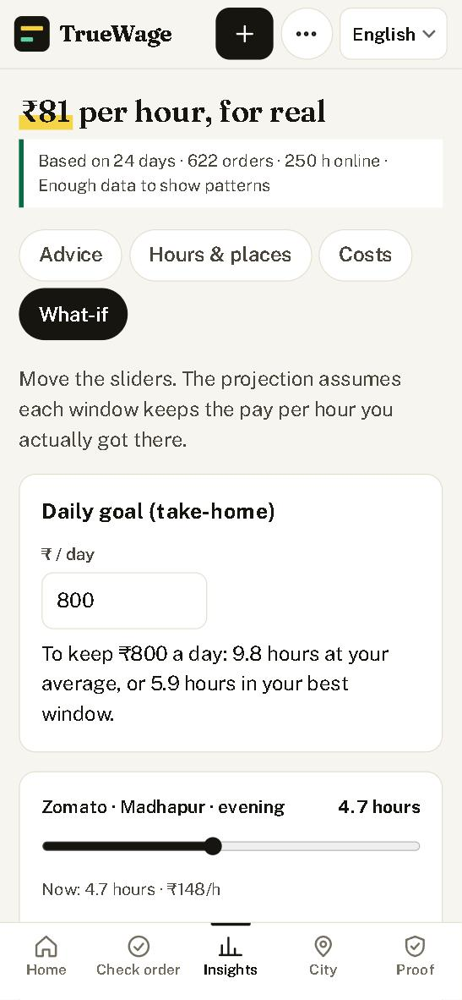

# TrueWage

**Platforms show what you earned. TrueWage shows what you actually made.**

Delivery partners and cab drivers on Swiggy, Zomato, Rapido and Ola see a headline earnings number. It ignores petrol, repairs, mobile data, the bike EMI, unpaid riding and the hours spent waiting for orders. TrueWage turns screenshots of the earnings screen into the number that matters: **cash in hand, and real pay per hour**.

| Home | Add screenshots: confirm | Check an order | What-if |
|---|---|---|---|
|  |  |  |  |

> All sample numbers in the screenshots and demo are **simulated** (a synthetic Hyderabad rider, 28 days). The app labels them as such wherever they appear.

## What it does

* **Rider accounts and private dashboards** – sign up with a name, 10-digit mobile number and password; every rider gets their own dashboard, and their data follows them across phones. Log in on a new phone and everything is there. Data made as a guest on the phone is merged into the account on sign-up. Without an account the app still works fully (data stays on that phone). Passwords are stored as salted **scrypt** hashes; the session is a random token in an `HttpOnly`, `SameSite=Strict` cookie (30 days, only a hash of it is stored); wrong-password attempts are throttled; every write carries a CSRF header; two devices editing at once are merged by record id (nothing is lost). Riders can change their password and **delete their account and all data** from the app. City contributions from an account use an anonymous HMAC id, so several phones count as one rider.
* **Plan my day** – enter a take-home goal; the app builds an ordered schedule from your own best windows ("17:00–23:00 · Zomato · Madhapur · about ₹135/hour") and says honestly when your history can't reach the goal.
* **Area switching** – "At lunch you earn ₹18/hour in Kukatpally. In Gachibowli riders earn about ₹X/hour (simulated city data). Try moving there." Your own better areas at the same time are preferred over city data.
* **Weekly coach** – this week against last week: one win, one thing to fix, and a week-by-week history table.
* **Hyderabad and Bengaluru** – simulated city analytics and a demo rider for each (Hyderabad: Madhapur, Gachibowli, Kondapur, Banjara Hills, Secunderabad, Uppal, Dilsukhnagar, Kukatpally; Bengaluru: Koramangala, Indiranagar, HSR Layout, Marathahalli, Whitefield, Jayanagar, Hebbal, Electronic City).
* **Shift tracker (hours and distance, as the project idea requires)** – tap *Start shift* when you go online and *Stop* when you finish. TrueWage measures your **online hours** (so waiting time is real, not guessed) and the **real distance you ride via GPS, including unpaid kilometres**. Only the running total distance is stored, never your route. After 3 shifts are paired with that day's screenshots (and 30+ paid km), the **GPS-measured unpaid-riding factor replaces our assumption** in every calculation and narrows the accuracy range. A tracked shift without screenshots is flagged ("Add that day's screenshots to see what it paid"). GPS fixes are filtered honestly: poor-accuracy fixes, jitter and impossible jumps are ignored.
* **Import in three taps** – *Add screenshots* → choose files → the app reads them and shows one card per screenshot (app, date, orders, total). Tap **Save** to see the result; tap *Edit orders* only if something looks wrong. Upload earnings screenshots (PNG/JPEG/WebP, several at once). Claude vision reads them when a key is configured on the server; otherwise on-device OCR (Tesseract.js) runs in the browser. The on-device reader cleans each screenshot first (scales it, flips dark themes, stretches contrast), reads it in up to three page-layout modes and keeps the best reading. It tolerates the usual OCR mistakes: a ₹ sign read as `?`, `%`, `¥` or even a leading digit (264 for ₹64, corrected only when the price per km would otherwise be impossible and **flagged for you to check**), `O`/`l` inside numbers, missing times, several date formats (13 Nov 2026, Nov 9, 09/11/2026, 2026-11-09) and online-time wording. A screen that shows only totals ("Today's earnings ₹1,240 · 14 trips") becomes a clearly flagged summary instead of failing. Nothing is saved until the rider has **reviewed and corrected** the extracted orders. Duplicate screenshots (by SHA-256) and duplicate sessions (same app, day and orders) are detected and skipped. Order-like lines the reader could not parse are counted and shown, not silently dropped. Out-of-range values block saving.
* **Cash in hand** – the home screen answers one question first: how much money did I actually make? A ledger runs from the app's total, through cuts, fuel, repairs, data, **profit before EMI**, the vehicle EMI, to **cash remaining**; every line is drawn as a waterfall step. View the whole period, a typical day or any single day.
* **Evidence-based advice** in English, हिन्दी, తెలుగు and தமிழ், with voice playback: most and least profitable windows, earnings per km, platform comparison, expense breakdown, waiting-time impact, break-even order value. With fewer than ~3 working days of data the app says so and shows no pattern advice.
* **Ask TrueWage** (floating button on every screen) – ask by typing or by **voice** in English, हिन्दी, తెలుగు or தமிழ். With a Claude key the server answers from a compact summary of *your own computed numbers* (no name, phone or screenshots are sent; the model is instructed never to invent numbers). Without a key an on-device engine picks the right result from your data (earnings, best time and place, what to avoid, order offers, costs, platforms, daily goal, fuel-price what-ifs). Every answer says which of the two produced it. Order offers are always computed exactly by the engine, never by the model.
* **Next best step** – one adaptive card on Home (confirm your vehicle → add more days → your next good window → share/proof), so nobody has to work out what to do next.
* **Honest accuracy** – the real hourly pay is shown with a range that reflects how uncertain the cost assumptions are, and a *Real petrol cost (₹/km)* calibration narrows it. Measured values (pay, bonuses, cuts, distance, times, EMI) never vary.
* **Made for phones** – opens in the phone's language on first visit, larger-text mode, installable ("Add to Home screen") with offline support, demo guide for first-time visitors.
* **Check order** (its own tab, for daily use) – enter the pay and distance an app offers and get Take it / Think twice / Skip it with a plain cost breakdown.
* **Insights** – four short panels: *Advice*, *Hours & places*, *Costs*, *What-if* (change hours per window, working days and fuel price; compare current vs projected monthly cash, real pay per hour and hours worked).
* **City** – three panels (*Where & when*, *Fair pay*, *Share*): pooled, anonymous pay by area, time of day and platform, plus a fair-pay floor calculator. The demo ships a **simulated** Hyderabad dataset. Real contributions go to the server; a cell is shown only when **20 or more distinct riders** contributed.
* **Income Proof** – printable statement with SHA-256 tamper detection, a QR code and a registry check. It states plainly that it is **self-reported**, not platform- or bank-certified.
* **Your data** – export/import a JSON backup, delete everything, all in the app.

## Using the AI reader carefully (cost and rate limits)

With `ANTHROPIC_API_KEY` set, Claude vision reads screenshots of **any layout** (order lists, single-trip breakups, daily summaries, new-order offers; low resolution and Indian languages included). It is built to use the API sparingly:

* **Shrink first:** the browser resizes each screenshot to at most 1568 px and re-encodes it (about 4x smaller uploads and far fewer image tokens).
* **One request per batch:** up to 8 screenshots go in a single call, not one call each.
* **Never pay twice:** the server caches the result per image (SHA-256 of the bytes), so the same screenshot costs nothing the second time, for any rider. The browser also skips files it already imported.
* **Cheap model first:** `TRUEWAGE_EXTRACT_MODEL` (default `claude-haiku-5-5`) reads everything; only images it could not read are retried once with `TRUEWAGE_ESCALATE_MODEL` (default `claude-sonnet-5-5`).
* **Hard budget:** `TRUEWAGE_AI_DAILY_IMAGES` (default 400) caps images sent upstream per day, on top of per-IP limits (20 requests/hour).
* **Backoff and fallback:** 429/overload responses are retried twice (honouring `Retry-After`); after that, or when the budget is spent, the browser automatically uses the on-device OCR reader and tells the rider.
* **Small replies:** output is capped at about 450 tokens per image, and Ask only ever sends a short summary of already-computed numbers.

Unknown values are never invented: missing times, distances or dates are guessed visibly and flagged in the review step; a history list that shows only some orders is topped up from its own totals as flagged filler; a new-order *offer* screen is recognised and sent to **Check order** instead of being imported as earnings.

## Run it (no key needed)

```bash
python server.py            # http://localhost:8080   (Python 3.9+, standard library only)
```

Press **Create my account** (two different riders on two browsers show the separate dashboards), or **Demo rider** to explore with sample data. For the real upload path press **Add screenshots → Try sample screenshots**: the app draws three genuine test screenshots, runs OCR on them, and stages the result for review. Tap a sample to download it, then upload it through the file picker.

Optional Claude vision: copy `.env.example` to `.env`, set `ANTHROPIC_API_KEY`, restart. The key stays on the server.

The front end is also fully static: any static host serves everything except the Claude reader, the statement registry and live city contributions (the UI says so when they are unavailable).

## How the numbers are computed

Each rupee is counted once.

```
gross             = pay + per-order incentive + share of day bonus - platform deductions
fuel              = (paid km + unpaid km) x fuel price / mileage
repairs           = (paid km + unpaid km) x repairs per km
mobile data       = online hours x data cost per hour
operating profit  = gross - fuel - repairs - data                      (before EMI)
EMI               = EMI per day x calendar days in the period, spread over worked days, then by online minutes
cash remaining    = operating profit - EMI
real pay per hour = cash remaining / online hours   (online hours include waiting)
```

* **Unpaid distance** = paid km x a factor for riding to restaurants and back to busy areas: **measured from GPS shifts when 3+ are paired with screenshots**, otherwise an editable assumption (default 0.45). It is part of fuel and repairs, shown as a note, never subtracted twice.
* **Waiting** = online time (from the screenshot, or from a tracked shift when the screenshot has none) minus time spent on orders. If a screenshot has no online time the review step warns that waiting is not counted and hourly pay is overstated.
* Defaults (mileage, fuel price, repairs, data, ₹90/h fair-wage line) are **editable assumptions**, not sourced statistics.
* Verified by tests: costs balance to the paisa (`gross - costs = cash`), EMI totals exactly `EMI/day x calendar days`, receipts add up, and the what-if simulator with unchanged inputs reproduces history exactly.

## Tests

```bash
node tests/engine.test.js                   # calculation engine, accuracy range, calibration, Ask intent detection in 4 languages, parser, duplicates, simulator
python -m unittest discover -s tests        # server (36 tests): accounts, sessions, CSRF, lockout, user isolation, validation, k-anonymity, registry, static whitelist, rate limit, extraction + Ask flow against a mock model API
python tools/smoke.py http://127.0.0.1:8080 # 33 checks against any running deployment (includes a register → save → logout → login → delete cycle)
```

What the tests do **not** prove: accuracy of the real Claude model on real screenshots (the extraction flow is tested against a local mock of the model API), and real-world OCR accuracy on arbitrary app layouts. The AI path is tested against a local mock of the Claude API (plumbing, caching, batching, retries, escalation, budget, sanitising) and, once, live: five real screenshots of five different layouts (order offer, day history with totals, trip breakup, trip detail, trip-complete) were all read correctly in one batched request (about 26 s, including one escalation). That is five screenshots, not a measured accuracy rate. On five real screenshots from the internet (an order offer, a day history with totals, a trip breakup, a trip detail and a trip-complete screen) the on-device OCR got most amounts wrong, which is why the AI reader is the primary path and why every import ends in a review step. On-device OCR was checked in the browser on the bundled samples and on generated dark-theme, low-resolution, no-₹-sign and totals-only screenshots (every order and amount recovered), but **never on real screenshots from the Swiggy, Zomato or Rapido apps**: their layouts change and we had none to test. That is why every import ends in a review step, and why flagged corrections and guesses are shown.

## Architecture

```
index.html · css/style.css
js/engine.js   pure maths and insight generation (Node-testable): costing, receipts, plan, what-if, statement
js/reader.js   Claude-vision client, Tesseract OCR fallback, parser, duplicate detection, validation
js/ask.js      offline question understanding (intents + numbers, 4 languages)
js/demo.js     synthetic rider month, simulated city data, sample screenshot renderer
js/i18n.js     English / Hindi / Telugu / Tamil strings
js/app.js      UI (light, high-contrast theme; 48 px touch targets; no horizontal scrolling at 390 px), account sync
server.py      static files (whitelist) + API, stdlib only
accounts.py    users, sessions, per-rider data (SQLite, scrypt), stdlib only
```

API: `GET /api/health` · `POST /api/extract` · `POST /api/ask` · `POST /api/statement`, `GET /api/statement/<id>` · `POST /api/contribute`, `GET /api/city` · `POST /api/auth/register|login|logout` · `GET /api/me` · `PUT /api/me/data` · `POST /api/me/password` · `DELETE /api/me`.

## Security and privacy

* The API key is read from the environment or an untracked `.env`, never sent to the browser, never logged.
* Only `index.html`, `css/*.css` and `js/*.js` are served; source, data and config files are not reachable (tested).
* Uploads are checked for type, magic bytes, size and count; model output is coerced to a strict schema; per-IP rate limits protect the API key; security headers on every response; atomic file writes.
* Screenshots are never written to disk. The statement registry stores a hash and the statement summary (name and last four digits of phone only if the rider typed them).
* City sharing is opt-in and sends only platform, area, time-of-day and ₹/hour (plus a random anonymous id kept in the browser). Simulated data is never submitted.

## Honest limitations

* **No SMS or email:** accounts are phone number + password and the number is not verified. A **forgotten password cannot be recovered** (the app says so at sign-up). A production version would add OTP verification and recovery. Account data is stored unencrypted in the server's SQLite file (`TRUEWAGE_DATA/truewage.db`): protect and back up that folder, and serve over HTTPS (set `TRUEWAGE_TRUST_PROXY=1` behind a proxy so the cookie is marked `Secure`).
* Accounts were tested with automated tests, the smoke test and manual two-rider browser sessions on localhost, not under real load or on a real multi-device setup.

* The income statement is rider-attested and tamper-evident. It is **not** platform-certified or bank-certified. The next step would be platform-signed exports or an Account-Aggregator-style consent flow.
* A lender needs the registry (server mode) to detect a forged *code*; the static link only detects an *edited number*.
* The what-if assumes each window keeps the pay per hour seen in the rider's own history; extra hours in a window may earn less.
* City analytics shown in the demo are simulated. Live data appears only after 20+ real contributors.
* GPS tracking needs location permission and the page kept open (an installed app works best); browsers pause location in the background. It was verified with simulated GPS fixes in development, not on a real ride.
* Voice input needs a browser with the Web Speech API (Chrome on Android works; support for Indian languages depends on the device). Typing always works.
* Offline mode (service worker) is implemented but could not be verified in the development browser pane; test it in Chrome after deploying.
* OCR needs internet once to fetch Tesseract.js and Google Fonts from CDNs.

## Deploy

See [deploy/VULTR.md](deploy/VULTR.md): Docker Compose (with optional automatic HTTPS) or a plain systemd service on a Vultr Ubuntu server. The Dockerfile and compose file have **not been built or run by the author** (Docker was not available in the development environment); CI builds the image and runs `tools/smoke.py` against it.

## Contributing

`engine.js` is pure and has no DOM dependency; add a test in `tests/engine.test.js` for any calculation change.
