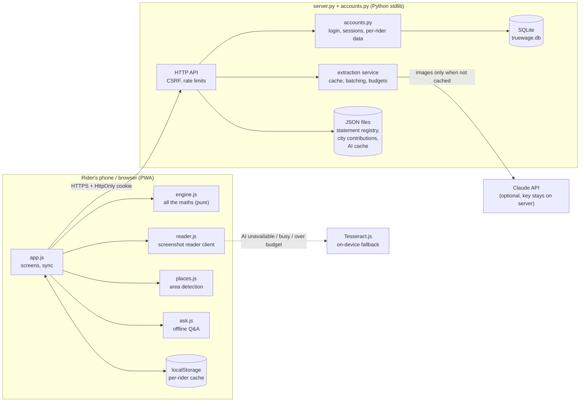
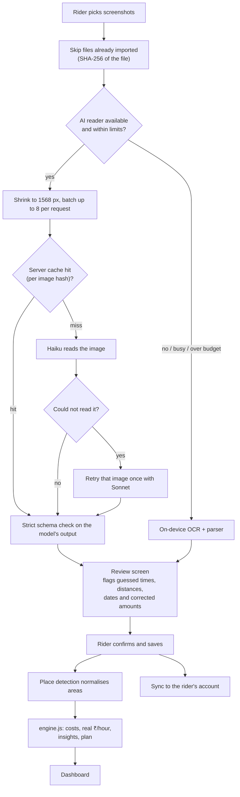
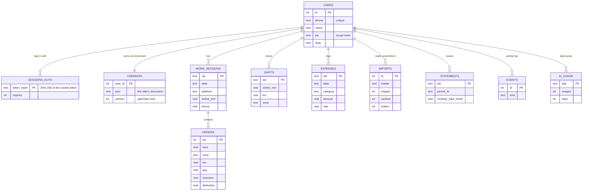
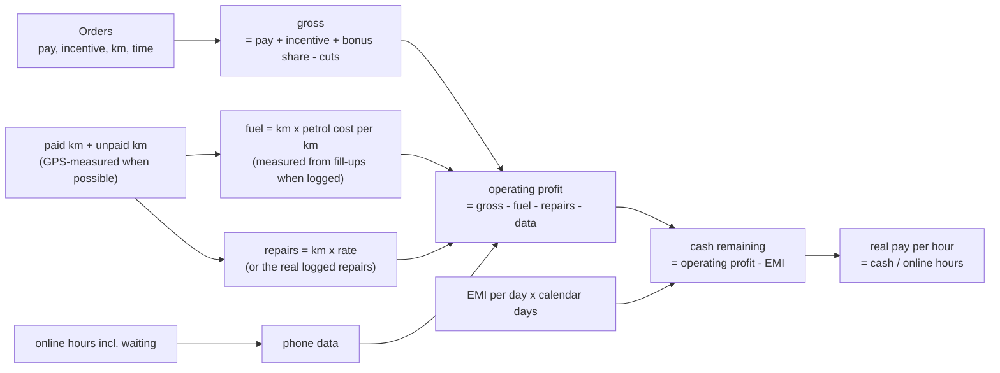
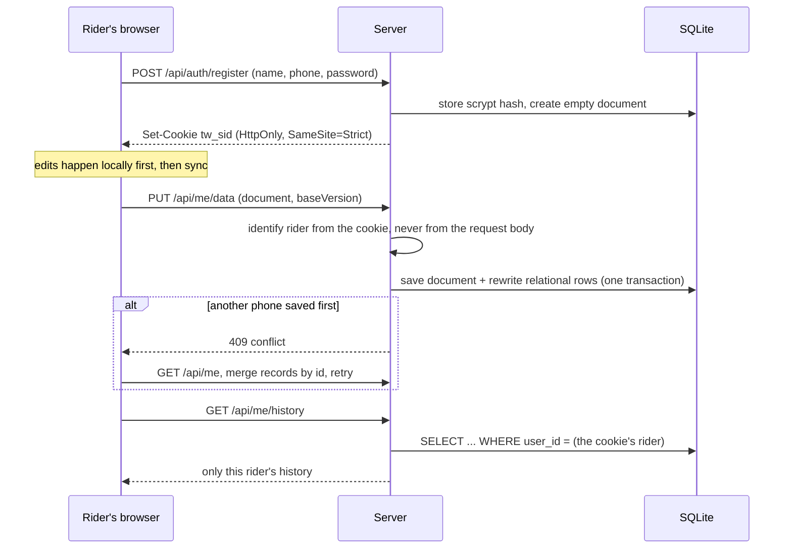

# TrueWage

**Platforms show what you earned. TrueWage shows what you actually made.**

[](https://github.com/Pegasus717/TrueWage/actions/workflows/ci.yml)
  

Delivery partners and cab drivers on Swiggy, Zomato, Rapido and Ola see a headline earnings number. It ignores petrol, repairs, mobile data, the vehicle EMI, unpaid riding and hours spent waiting. TrueWage reads a rider's earnings screenshots and shows the number that matters: **cash in hand and real pay per hour**.

> Sample numbers, the demo riders and the city dashboard are **simulated** and labelled as such inside the app.

---

## Contents

1. [What it does](#1-what-it-does)
2. [Architecture](#2-architecture)
3. [Accounts and data storage](#3-accounts-and-data-storage)
4. [Quick start](#4-quick-start)
5. [Configuration](#5-configuration)
6. [How the numbers are computed](#6-how-the-numbers-are-computed)
7. [Reading screenshots (AI + on-device fallback)](#7-reading-screenshots-ai--on-device-fallback)
8. [API](#8-api)
9. [Testing](#9-testing)
10. [Security and privacy](#10-security-and-privacy)
11. [Known limitations](#11-known-limitations)
12. [Deployment and project layout](#12-deployment-and-project-layout)

---

## 1. What it does

| For the rider | What they get |
|---|---|
| **Know the truth** | A speedometer shows real ₹/hour against what the apps imply and a fair-wage line; a ledger runs from the apps' total, through cuts, fuel, repairs, data and EMI, to cash remaining. |
| **Add data without typing** | Upload screenshots of any app or layout; the AI reads them, the rider reviews and saves. Duplicates are skipped. |
| **Track the real day** | Shift tracker (online hours + GPS distance, including unpaid km), expense log with fuel fill-ups that measure the *real* petrol cost per km. |
| **Decide faster** | *Check order* (take / think twice / skip), *Plan my day* from a goal, best day-and-time grid, area switching advice, weekly coach, what-if simulator. |
| **Ask in their language** | Typed or voice questions in English, हिन्दी, తెలుగు, தமிழ் answered from the rider's own numbers. |
| **Prove income** | A printable, tamper-evident income statement (SHA-256 + QR) for a lender. It says clearly it is self-reported. |
| **Keep their history** | Private account, history screen, full CSV export, delete-my-account. |
| **Unions and researchers** | Anonymous city analytics, shown only when 20 or more riders contributed (k-anonymity). |

Place detection resolves 42 Hyderabad and Bengaluru areas from GPS (minutes per area only, never the route) or from address text on screenshots (aliases, truncated words such as "Cherlapa...", OCR typos). Unknown places stay "Unknown" and are never guessed.

---

## 2. Architecture

TrueWage is a plain-JavaScript web app (no build step) served by a small Python server that uses only the standard library, with SQLite for storage.

### 2.1 System overview



Design rules that keep it simple and trustworthy:

* **One calculation engine.** `engine.js` is pure (no DOM, no network) and is unit-tested in Node. The browser and the tests run the same code.
* **The server never does the maths.** It stores data, authenticates, and brokers the AI call.
* **The AI reads; the engine calculates.** Claude turns pixels into structured orders. Every rupee figure shown to the rider comes from the tested engine.
* **Works without an account or a key.** Guest mode keeps data on the phone; without an API key the on-device reader is used.

### 2.2 From screenshot to dashboard



### 2.3 Data model

Each rider has **one versioned JSON document** (what the app syncs) and a **relational copy** that is rewritten in the same transaction, so history can be queried, exported and audited with plain SQL.



Every table is keyed by `user_id` and deleted automatically (`ON DELETE CASCADE`) when the rider deletes their account.

### 2.4 How the engine turns orders into cash



---

## 3. Accounts and data storage

**Yes: every rider has a separate login, a separate dashboard and separate stored data.**



| Question | Answer |
|---|---|
| Separate dashboard per rider? | Yes. Data is always read through the rider's own session cookie; no user id is ever accepted from the client. |
| Where is data stored? | SQLite (`data/truewage.db`): the rider's document, plus tables for work sessions, orders, shifts, expenses, imports, statements, activity and AI usage. |
| On another phone? | Log in and the same data appears. Edits from two phones at once are merged by record id; nothing is lost. |
| Passwords | scrypt (N=2^14) with a random salt per user; compared in constant time; never logged. |
| Sessions | 32-byte random token in an `HttpOnly`, `SameSite=Strict` cookie (`Secure` over HTTPS), 30 days; only its SHA-256 is stored. |
| Brute force | 5 wrong attempts per phone and IP per 15 minutes; unknown phones cost the same hashing time. |
| CSRF | Every state-changing call needs a custom header and a matching `Origin`. |
| Guests | Without an account, data stays on that phone; signing up later merges it into the account. |
| History and export | *My history* screen and *Download all my data (CSV)* (formula-injection safe). |
| Deleting | *Delete my account* removes the account and every row. |

This is covered by automated tests (isolation between two riders, token invalidation, lockout, CSRF, conflict handling, cascade delete, CSV safety, quotas). See [Testing](#9-testing) and the limits in [Known limitations](#11-known-limitations): there is **no SMS or e-mail**, so a forgotten password cannot be recovered.

---

## 4. Quick start

Requirements: Python 3.9+ and a browser. Nothing to install.

```bash
git clone https://github.com/Pegasus717/TrueWage.git
cd TrueWage
python server.py          # open http://localhost:8080
```

1. Press **Create my account**, or **Demo rider** to explore with sample data.
2. Press **Add screenshots**, then **Try sample screenshots** to see the reader and review step without any key.
3. To use the AI reader, copy `.env.example` to `.env`, set `ANTHROPIC_API_KEY`, and restart. The key never leaves the server.

Two riders in two browsers see two separate dashboards.

---

## 5. Configuration

All settings are optional environment variables (or a git-ignored `.env` file).

| Variable | Default | Purpose |
|---|---|---|
| `ANTHROPIC_API_KEY` | none | Enables the AI screenshot reader and AI Ask. Without it the app uses the on-device reader. |
| `TRUEWAGE_EXTRACT_MODEL` | `claude-haiku-5-5` | First-pass screenshot reader (cheap). |
| `TRUEWAGE_ESCALATE_MODEL` | `claude-sonnet-5-5` | Retries only images the first pass could not read. |
| `TRUEWAGE_MODEL` | `claude-haiku-5-5` | Ask answers (short, grounded in the rider's numbers). |
| `TRUEWAGE_AI_DAILY_IMAGES` | `400` | Server-wide daily cap on images sent to the AI. |
| `TRUEWAGE_AI_USER_DAILY` | `60` | Images one signed-in rider may have read per day. |
| `TRUEWAGE_AI_USER_ASKS` | `100` | Ask questions per rider per day. |
| `TRUEWAGE_DATA` | `./data` | Folder for the database and JSON files. Back it up. |
| `TRUEWAGE_TRUST_PROXY` | `0` | Set `1` behind your own HTTPS proxy (real client IP, `Secure` cookie). |
| `TRUEWAGE_COOKIE_SECURE` | `0` | Force the `Secure` cookie flag. |
| `PORT` | `8080` | Listen port. |

**Keeping API use low:** images are shrunk before upload, sent in batches of up to 8, cached per image (the same screenshot never costs twice), read by the cheap model first, capped per rider and per day, retried with backoff on 429, and replaced by on-device OCR when the AI is busy or over budget. Ask replies are capped at 350 tokens and identical questions are cached for 10 minutes.

---

## 6. How the numbers are computed

Each rupee is counted once.

```
gross             = pay + per-order incentive + share of day bonus - platform deductions
fuel              = (paid km + unpaid km) x petrol cost per km
repairs & other   = (paid km + unpaid km) x repairs per km      (replaced by real logged repairs/costs when present)
mobile data       = online hours x data cost per hour
operating profit  = gross - fuel - repairs & other - data        (before EMI)
EMI               = EMI per day x calendar days, spread over worked days, then by online minutes
cash remaining    = operating profit - EMI
real pay per hour = cash remaining / online hours                (online hours include waiting)
```

* **Unpaid distance** is measured from GPS shifts once 3 are paired with screenshots (30+ paid km); until then it is an editable assumption (default 0.45 of paid km).
* **Petrol cost per km** is measured from fill-ups with odometer readings once 2 intervals exist; until then it is price divided by mileage. A manual value always wins.
* **Long gaps in the data** count as at most 3 days, so one old screenshot cannot make the rider "pay" months of EMI.
* The home screen shows a **range** for real pay per hour that reflects how uncertain the assumptions are. Measured values (pay, bonuses, cuts, distance, times, EMI) never vary.
* Defaults (mileage, petrol price, repairs, data, ₹90/h fair-wage line) are editable assumptions, not sourced statistics.

---

## 7. Reading screenshots (AI + on-device fallback)

* **AI reader (primary).** Handles order lists, single-trip breakups, daily summaries and order offers in any layout, including low resolution and Indian languages. It returns one record per image with `null` for anything it cannot see; the server validates and clamps every field.
* **Order offers** (a new order a rider can still accept) are recognised and sent to *Check order* instead of being saved as earnings.
* **Partial history screens** ("14 orders, ₹3,109" with only 2 listed) keep the visible orders and top up the rest from the screen's own total, clearly flagged.
* **Review before saving.** Guessed times, distances and dates, filler orders and corrected amounts are listed so the rider can fix them. Out-of-range values block saving.
* **On-device fallback.** Tesseract.js with image clean-up (scaling, dark-theme inversion, contrast), three page-layout modes, a parser that tolerates misread ₹ signs and numbers, and card-style layouts.

---

## 8. API

| Method and path | Auth | Purpose |
|---|---|---|
| `GET /api/health` | none | Status and whether AI is enabled (never the key). |
| `POST /api/auth/register`, `/login`, `/logout` | none / cookie | Account and session. |
| `GET /api/me` | cookie | Profile, document, version, AI usage. |
| `PUT /api/me/data` | cookie | Save the document (optimistic version check). |
| `GET /api/me/history`, `GET /api/me/export.csv` | cookie | History from the database; full CSV export. |
| `POST /api/me/password`, `DELETE /api/me` | cookie | Change password; delete everything. |
| `POST /api/extract` | optional | Read screenshots with AI (cached, batched, budgeted). |
| `POST /api/ask` | optional | Answer a question from the rider's computed numbers. |
| `POST /api/statement`, `GET /api/statement/<id>` | none | Register / verify an income-statement hash. |
| `POST /api/contribute`, `GET /api/city` | none | Opt-in anonymous contributions; k-anonymous city results. |

All state-changing calls require the `X-TW: 1` header (CSRF defence).

---

## 9. Testing

```bash
node tests/engine.test.js                    # calculation engine, readers, places, expenses, heatmap, Ask intents
python -m unittest discover -s tests         # server and accounts (47 tests)
python tools/smoke.py http://127.0.0.1:8080  # 33 checks against any running deployment
```

* **Engine:** costs balance to the paisa, EMI totals exactly, receipts add up, the what-if simulator reproduces history when nothing changes, expenses are counted once, fuel calibration, weekday heatmap.
* **Server:** accounts, cookies, lockout, CSRF, user isolation, versioned sync, relational mirror, history and CSV, quotas, validation, k-anonymity, static whitelist, rate limits.
* **AI path** against a local mock of the Claude API: batching, per-image cache, retries, escalation, daily budget, sanitising, Ask cache. The tests never call the real API.
* **Live check:** five real screenshots of five different layouts were read correctly through the real API. That is a spot check, **not a measured accuracy rate**.

---

## 10. Security and privacy

* The API key stays on the server (environment or git-ignored `.env`); never sent to the browser or logged.
* Only `index.html`, CSS and JS are served; source, data and config files are not reachable (tested).
* Uploads are checked for type, magic bytes, size and count; model output is coerced to a strict schema; per-IP and per-rider limits protect the API budget; security headers on every response.
* **Screenshots are never written to disk.** The AI cache stores only extracted order numbers, keyed by image hash.
* The model is told to return area names only, never names, phone numbers, order ids or addresses. Ask sends only a short summary of computed numbers.
* City sharing is opt-in and sends platform, area, time band and ₹/hour under an anonymous id (HMAC of the account, not reversible without the server secret). Simulated data is never submitted.

---

## 11. Known limitations

* **No SMS or e-mail.** Accounts are phone number + password; the number is not verified and a forgotten password cannot be recovered. Production would add OTP verification and recovery.
* Account data is stored unencrypted in the server's SQLite file: protect and back up `TRUEWAGE_DATA` and serve over HTTPS.
* AI reading accuracy has been spot-checked on five real screenshots, not measured on a large set. On-device OCR is weaker on real app screenshots, which is why the AI is primary and every import ends in a review step.
* The income statement is rider-attested and tamper-evident, **not** platform- or bank-certified.
* City analytics in the demo are simulated; live cells appear only after 20+ real contributors.
* GPS tracking needs permission and the page kept open; it was verified with simulated fixes, not on a real ride. Voice input depends on the browser (Chrome on Android works best). Offline mode could not be verified in the development browser.
* The Docker and Vultr deployment files are written but have not been run by the authors; CI builds the image and runs the smoke test against it.

---

## 12. Deployment and project layout

See [deploy/VULTR.md](deploy/VULTR.md) for Docker Compose (with automatic HTTPS) or a plain systemd service on a Vultr Ubuntu server.

```
index.html, css/style.css, manifest.json, sw.js, icon.svg   web app shell (installable PWA)
js/engine.js     calculation engine: costs, receipts, plans, what-if, statements (pure, tested)
js/reader.js     screenshot reader client: AI request, on-device OCR, parsers, validation
js/places.js     place detection from addresses and GPS
js/ask.js        offline question understanding (4 languages)
js/demo.js       simulated riders and city data, sample screenshots
js/i18n.js       English / Hindi / Telugu / Tamil strings
js/app.js        screens, account sync, shift tracker
server.py        HTTP API, static files, AI brokering, rate limits
accounts.py      users, sessions, per-rider data, history, export, quotas (SQLite)
tests/           engine, server, accounts and AI-flow tests
tools/smoke.py   deployment smoke test
deploy/          Docker, Caddy, systemd and Vultr guide
```

**Contributing:** `engine.js` has no DOM dependency; add a test in `tests/engine.test.js` for any calculation change.

**Team:** [Pegasus717](https://github.com/Pegasus717) and [wildwolf06](https://github.com/wildwolf06).
