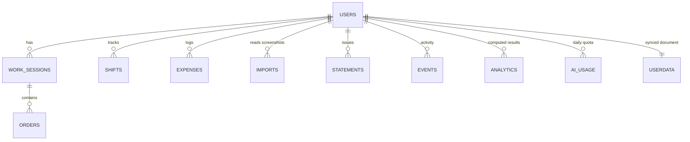
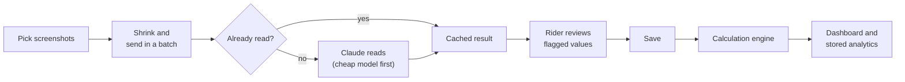
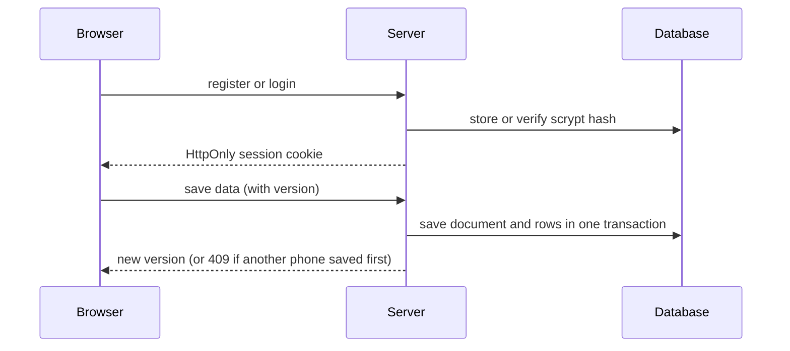
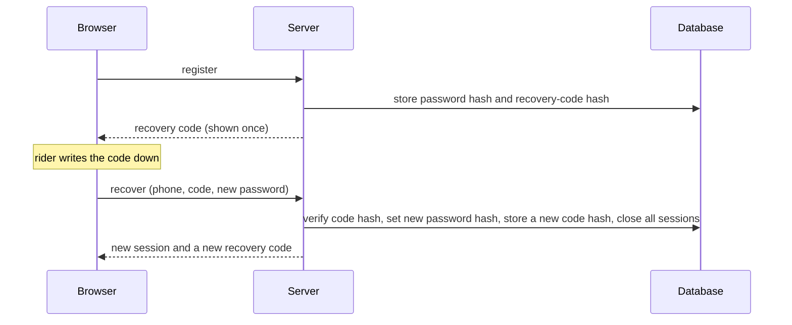

# Architecture details

## Data model

Each rider's rows are tied to their account and deleted with it. The full schema is in [../deploy/supabase_schema.sql](../deploy/supabase_schema.sql); the server creates it on start-up.



Per-rider tables also include `review_stats` (counts of corrections after each reading). Server-wide tables: `registry` (statement hashes), `contributions` (anonymous city data), `extract_cache`, `ai_budget`, `kv`.

## Screenshot reading



When the AI is busy or the daily budget is used up, the browser falls back to on-device OCR and tells the rider.

## Login and sync



The server identifies the rider only from the session cookie, never from the request body.

## Account recovery

There is no SMS or e-mail, so a forgotten password is reset with a recovery code instead.



- The code is 20 characters from a 32-letter alphabet without look-alikes (100 random bits), stored only as a scrypt hash.
- A used code is replaced at once. A rider can also make a new one from the account screen with their password, which is how accounts created before v2 get their first code.
- Wrong guesses are limited to 5 per number and address and 30 per address in 15 minutes. An unknown number, a wrong code and an account with no code all return the same answer after the same amount of work.
- The same screen has a button that closes every session except the current one.

## Measured reading accuracy

After a rider checks a reading and saves, the app compares what the reader returned with what was saved and sends only counts: orders read, orders left unchanged, orders removed, orders added, values read and values changed. No amounts, places or screenshots are sent. A removed order counts as all six of its values being wrong. Readings of the built-in sample screenshots are never counted.

`GET /api/accuracy` returns the totals per reader (`ai` or `ocr`). A percentage is returned only once at least 100 values have been checked. The admin overview shows the same figures.

## Service reminder

The reminder is computed in the browser from the odometer readings riders already enter with fuel fill-ups and services. It needs at least one service with an odometer reading, and the interval (default 3,000 km) is the rider's setting. A logged service is counted as a repair cost and replaces the per-km repair estimate for that period.

## How the numbers are calculated

```
gross             = pay + incentives + bonus share - platform deductions
fuel              = (paid km + unpaid km) x petrol cost per km
repairs and other = (paid km + unpaid km) x rate, or the real logged repairs
mobile data       = online hours x data cost per hour
cash remaining    = gross - fuel - repairs - data - EMI
real pay per hour = cash remaining / online hours (waiting included)
```

- Unpaid distance is measured from GPS shifts once three are matched with screenshots; until then it is an editable assumption.
- Petrol cost per km is measured from fill-ups with odometer readings once two intervals exist.
- A long gap in the data counts as at most three days, so one old screenshot cannot create months of EMI.
- Defaults such as mileage, fuel price and the Rs 90 per hour fair-wage line are editable assumptions, not sourced statistics.

## API

| Endpoint | Purpose |
|---|---|
| `POST /api/auth/register`, `/login`, `/logout` | Account and session. Register also returns the recovery code, once. |
| `POST /api/auth/recover` | Reset a forgotten password with the recovery code |
| `POST /api/me/recovery`, `/api/me/logout-others` | Make a new recovery code (needs the password); log out all other devices |
| `GET /api/me`, `PUT /api/me/data` | Profile and the rider's saved data |
| `GET /api/me/history`, `GET /api/me/export.csv` | History and CSV export |
| `POST /api/extract` | Read screenshots with AI |
| `POST /api/me/review` | Counts of what the rider corrected after a reading |
| `GET /api/accuracy` | Measured accuracy per reader |
| `POST /api/ask` | Answer a question from the rider's numbers |
| `POST /api/statement`, `GET /api/statement/<id>` | Register and verify an income statement |
| `POST /api/contribute`, `GET /api/city` | Anonymous city data |
| `GET /api/health` | Status (never returns secrets) |

State-changing requests need the `X-TW: 1` header and a matching origin.

## Project structure

```
index.html, css/, manifest.json, sw.js   web app shell (installable PWA)
js/engine.js     calculation engine (pure, unit-tested)
js/reader.js     screenshot reader client and on-device OCR
js/places.js     place detection from addresses and GPS
js/app.js        screens, account sync, shift tracker
server.py        HTTP API, static files, AI brokering, rate limits
accounts.py      users, sessions, per-rider data, history, export, quotas
store.py         storage layer (Supabase PostgreSQL or SQLite)
tests/, tools/   tests, smoke test, database check, accuracy tool
deploy/          Render, Supabase, Docker and Vultr guides
```
