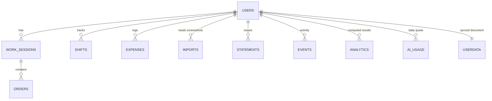
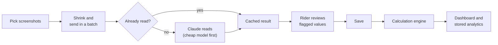
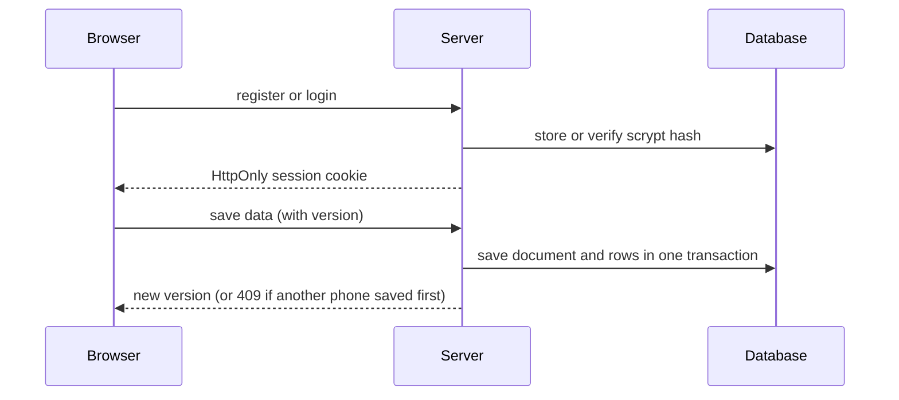
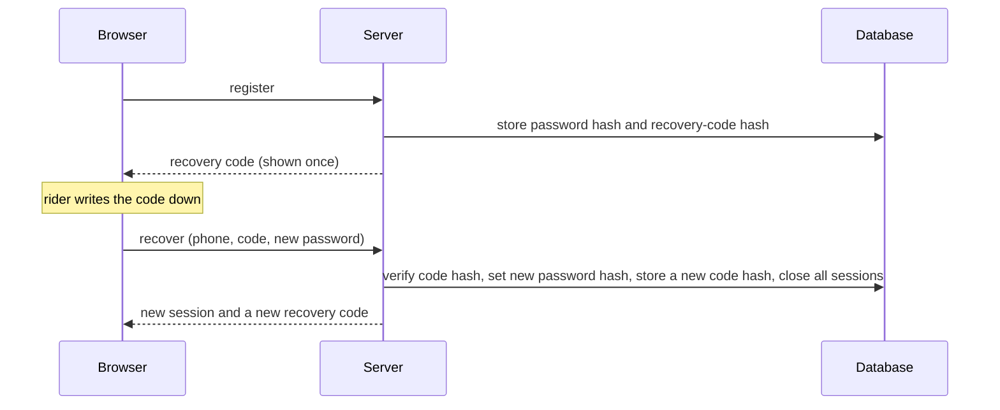

# Architecture details

## Data model

Each rider's rows are tied to their account and deleted with it. The full schema is in [../deploy/supabase_schema.sql](../deploy/supabase_schema.sql); the server creates it on start-up.



Per-rider tables also include `review_stats` (counts of corrections after each reading). Server-wide tables: `registry` (statement hashes), `contributions` (anonymous city data), `extract_cache`, `ai_budget`, `kv`.

## Screenshot reading



When the AI is busy or the daily budget is used up, the browser falls back to on-device OCR and tells the rider.

## Login and sync



The server identifies the rider only from the session cookie, never from the request body.

## Account recovery

There is no SMS or e-mail, so a forgotten password is reset with a recovery code instead.



- The code is 20 characters from a 32-letter alphabet without look-alikes (100 random bits), stored only as a scrypt hash.
- A used code is replaced at once. A rider can also make a new one from the account screen with their password, which is how accounts created before v2 get their first code.
- Wrong guesses are limited to 5 per number and address and 30 per address in 15 minutes. An unknown number, a wrong code and an account with no code all return the same answer after the same amount of work.
- The same screen has a button that closes every session except the current one.

## Measured reading accuracy

After a rider checks a reading and saves, the app compares what the reader returned with what was saved and sends only counts: orders read, orders left unchanged, orders removed, orders added, values read and values changed. No amounts, places or screenshots are sent. A removed order counts as all six of its values being wrong. Readings of the built-in sample screenshots are never counted.

`GET /api/accuracy` returns the totals per reader (`ai` or `ocr`). A percentage is returned only once at least 100 values have been checked. The admin overview shows the same figures.

## Service reminder

The reminder is computed in the browser from the odometer readings riders already enter with fuel fill-ups and services. It needs at least one service with an odometer reading, and the interval (default 3,000 km) is the rider's setting. A logged service is counted as a repair cost and replaces the per-km repair estimate for that period.

## Edit records and merging two devices

A rider can correct a day, split it, merge two days or remove the last import (Data > Edit records). The previous state of the records is kept in memory for 10 undo steps while the app is open.

Two devices may edit at the same time, so the merge rules are explicit and covered by `tests/merge.test.js`:
- Each edited day carries a `rev` timestamp. When both devices have the same day, the later edit wins; an older copy never overwrites a newer one.
- A deletion is recorded as a tombstone (`gone`: id and time, kept 90 days). A record deleted on either device is removed on both and cannot come back from a stale copy. Expenses and payouts use the same list.
- New days, expenses and payouts added on either device are all kept.

## Weeks, months and payout check

`engine.periods` groups the analysed orders into Monday to Sunday weeks or calendar months. Each period has the same cost breakdown as the whole analysis, a split by app, and the change against the period before when that one exists. The last period is marked "so far" when it runs past the latest data.

`engine.reconcile` compares a payout the rider typed in (app, dates, amount) with the sum of that rider's own orders for the same app and dates (pay + incentive - deduction + day bonus). Within the larger of Rs 30 and 2% it is a match; otherwise "short" or "over"; with no orders in the period it gives no verdict. A gap can also mean orders were never imported, which the screen says.

## App comparison

`engine.comparePlatforms` returns, for each app, real pay per hour and keep ratio. With at least 3 days and 3 hours it adds an 80% range: the rider's working days are resampled with replacement 400 times (seeded, so the same data always gives the same range) and the 10th and 90th percentiles are taken. For each time of day it compares apps that have 3 days and 2 hours there: "clear" when the best beats the next by at least Rs 10 or 15%, otherwise "close".

## Income statement v2

The registered statement (`version: 2`) adds a month-by-month table, the average and weakest month that had at least 10 worked days, the EMI the income can carry on both, the vehicle loan or rent counted, and the provenance of the order records (share read by AI, read by phone OCR, typed by hand, and orders edited afterwards). It is still hashed with SHA-256; the code `TW-<12 hex>` comes from the hash and the public page `#verify=TW-...` re-computes it and checks the registry. The page and the printed A4 sheet use the same layout.

## Backups, migrations and monitoring

**Migrations.** `store.py` creates tables with `CREATE ... IF NOT EXISTS`; anything that changes an existing table is a numbered migration in `store.MIGRATIONS`, run once in order inside one transaction and recorded in `schema_migrations`. A failing migration rolls back completely (SQLite is put in an explicit transaction for this). Before the first migration of an existing SQLite database a copy is written to `data/backups/pre-migrate-v<N>-<time>.db`. On Postgres an advisory lock serialises servers that start together. Never edit a shipped migration; add a new one.

**Backups.** `python backup.py dump` writes every table except login sessions, the AI cache, the migration record and the error log to one gzip'd JSON file with row counts. `verify` checks that the file is complete; `drill` restores it into a throw-away SQLite database and compares every table's row count; `restore` loads it into the active database (refused if riders exist unless `--replace`; column names are checked against the live schema, and it is one transaction). `GET /api/admin/backup` downloads a dump as an admin. A background thread writes a dump every `TRUEWAGE_BACKUP_EVERY_H` hours and keeps the newest `TRUEWAGE_BACKUP_KEEP`; it is on for SQLite and off for PostgreSQL unless `TRUEWAGE_BACKUP_DIR` is set. `.github/workflows/backup.yml` dumps the hosted database daily, runs `verify` and `drill`, encrypts the file with `openssl` and keeps it as a private workflow artifact for 14 days. It needs the repository secrets `DATABASE_URL` (the Supabase session pooler string) and `BACKUP_PASSPHRASE`.

**Monitoring.**
- `GET /api/health` is liveness (the process is up); `GET /api/health/ready` also checks the database and answers 503 when it does not respond. `uptime.yml` calls the readiness endpoint every 10 minutes and fails, which e-mails the repository owner, when the site is down. It also keeps a free Render instance awake.
- `GET /api/metrics` (admin session or `TRUEWAGE_METRICS_TOKEN`) returns Prometheus text: requests and 5xx errors per route group, p95 latency, AI events, database status, schema version, errors in 24 h and the age of the last backup. Route names come from a fixed list, so scanners cannot create unlimited series.
- Every API request writes one JSON line to standard output with a request id (also returned as `X-Request-Id`). Unhandled exceptions answer 500 with that id and are stored in `error_log`; the app reports its own crashes to `POST /api/client-error` (message, file name and line, at most 5 per page). Messages are scrubbed of long digit runs and URLs; the newest 500 are kept.
- The admin overview has a System panel: uptime, database latency, schema version, last backup, errors and a backup download.

## How the numbers are calculated

```
gross             = pay + incentives + bonus share - platform deductions
fuel              = (paid km + unpaid km) x petrol cost per km
repairs and other = (paid km + unpaid km) x rate, or the real logged repairs
mobile data       = online hours x data cost per hour
cash remaining    = gross - fuel - repairs - data - EMI
real pay per hour = cash remaining / online hours (waiting included)
```

- Unpaid distance is measured from GPS shifts once three are matched with screenshots; until then it is an editable assumption.
- Petrol cost per km is measured from fill-ups with odometer readings once two intervals exist.
- A long gap in the data counts as at most three days, so one old screenshot cannot create months of EMI.
- Defaults such as mileage, fuel price and the Rs 90 per hour fair-wage line are editable assumptions, not sourced statistics.

## API

| Endpoint | Purpose |
|---|---|
| `POST /api/auth/register`, `/login`, `/logout` | Account and session. Register also returns the recovery code, once. |
| `POST /api/auth/recover` | Reset a forgotten password with the recovery code |
| `POST /api/me/recovery`, `/api/me/logout-others` | Make a new recovery code (needs the password); log out all other devices |
| `GET /api/me`, `PUT /api/me/data` | Profile and the rider's saved data |
| `GET /api/me/history`, `GET /api/me/export.csv` | History and CSV export |
| `POST /api/extract` | Read screenshots with AI |
| `POST /api/me/review` | Counts of what the rider corrected after a reading |
| `GET /api/health`, `GET /api/health/ready` | Liveness; readiness including the database |
| `GET /api/metrics` | Prometheus metrics (admin or token) |
| `POST /api/client-error` | The app reporting a crash (scrubbed, rate-limited) |
| `GET /api/admin/overview`, `GET /api/admin/backup` | Admin overview with System panel; database dump download |
| `GET /api/accuracy` | Measured accuracy per reader |
| `POST /api/ask` | Answer a question from the rider's numbers |
| `POST /api/statement`, `GET /api/statement/<id>` | Register and verify an income statement |
| `POST /api/contribute`, `GET /api/city` | Anonymous city data |
| `GET /api/health` | Status (never returns secrets) |

State-changing requests need the `X-TW: 1` header and a matching origin.

## Project structure

```
index.html, css/, manifest.json, sw.js   web app shell (installable PWA)
js/engine.js     calculation engine (pure, unit-tested)
js/reader.js     screenshot reader client and on-device OCR
js/places.js     place detection from addresses and GPS
js/app.js        screens, account sync, shift tracker
server.py        HTTP API, static files, AI brokering, rate limits
accounts.py      users, sessions, per-rider data, history, export, quotas
store.py         storage layer (Supabase PostgreSQL or SQLite)
tests/, tools/   tests, smoke test, database check, accuracy tool
deploy/          Render, Supabase, Docker and Vultr guides
```
